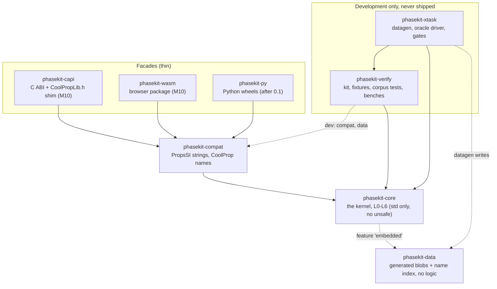
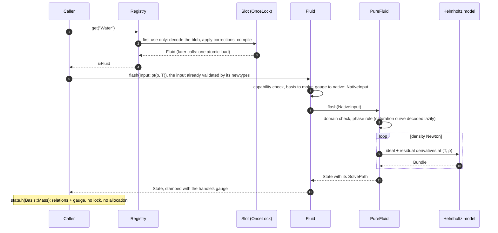
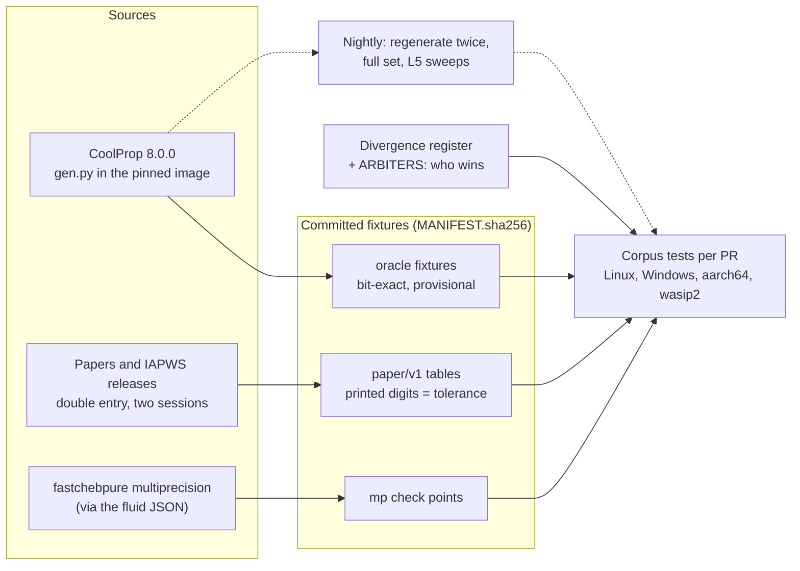

# phasekit architecture

**Status:** living. The design: decisions D1-D17, the seams and their invariants, and why. What is built is the code
in `crates/`; where this file and the code disagree on a signature, the code is right and this file is fixed.
[DECISIONS.md](DECISIONS.md) overrides anything older here.
**Name:** `phasekit` (D16, decided 2026-10-05): crates `phasekit-*`, Rust paths `phasekit_*`, C symbols `pk_*`.
**How it was decided:** four competing proposals, three judges, two critiques and a decision log (critic issues
S-## and E##), all frozen in [docs/history/](history/README.md) with the type sketch that seeded the workspace.
**Companions:** [PLAN.md](PLAN.md) (milestones in detail), [VERIFICATION.md](VERIFICATION.md) (D13 in full),
[ROT-REGISTER.md](ROT-REGISTER.md) (the rot register; the divergence register is specified in VERIFICATION.md §6).
**Citations:** the forms, and where each fact lives: [PLAN.md §2.1](PLAN.md#21-ids-and-references).

**Thesis.** The scalar `f64` path is the specification. Every layer exposes a typed seam where an independent check
attaches. CoolProp 8.0.0 is a provisional oracle; printed check tables arbitrate; every deliberate difference is a
typed, cited, proof-tested register entry. Two object-safe model traits make the library open: `HelmholtzModel` for
equation-of-state families, and `ThermoModel` for anything that can be flashed, which is what the registry, the batch
driver and every facade hold. Two plug-in traits (`SaturationCurve`, `DataSource`), the sealed `Real` and
`RealKernel`, a family's kernel over `Real` that core runs in its private lanes, complete the extension surface: six
traits in all. Models are immutable and shared through `Arc`; a `State` is a small `Copy`
value (≤ 256 B). Concurrency then follows from the types, not from locks. Nothing ships in v0.1 without a caller.

## 1. Goals and non-goals

| BRIEF §1 (verbatim fragments) | Where the design satisfies it | Kept by |
|---|---|---|
| "a plan to migrate coolprop to rust" | D15 milestones (§4); [PLAN.md](PLAN.md) | PLAN.md §0.2 definition of done |
| "modular extensible" ... "modularity is again KEY" | §2 crates, §3 two model traits, §11 seams; out-of-tree family, Gibbs-solid and two-phase tests | `new_family.rs`, `gibbs_seam.rs` (G3, G4); `gates core-frozen` (M11, M14) |
| "memory safe" | `unsafe_code = "forbid"` everywhere except `phasekit-capi` (D17) | `gates lints` (every member inherits the workspace lints; only capi relaxes `unsafe_code`), M0.4 |
| "cross platform" ... "windows, linux, and wasm" | Linux, Windows and both wasm targets in CI (D17); WASM loading §8; Rust on wasip2 supported, a WIT component on demand (D11) | G4, G5, G6; CI windows, aarch64, wasm-browser jobs |
| "connected fluid properties library" (interpreted: embeddable in services, simulators, browsers) | Registries are values; Rust, C, WASM and Python facades (§12); a network server is an outer facade, never core | `policy_equivalence` (M9); C smoke (M10.4); JS smoke (M10.8). A network server is an on-demand facade (section 4) |
| "rot in there we can eliminate" | §13, [ROT-REGISTER.md](ROT-REGISTER.md) | `gates rot` (M0.4) |
| "DRY, SOLID code in idiomatic modern Rust" | One pair table, one input gate, one `Prop` table, one relations layer, one EOS encoder; small traits (ISP); families open/closed (OCP); edition 2024, newtypes, `Result` | G2, G7 |
| "minimal dependencies so other projects can use this" | Core has zero third-party dependencies until M9 (optional `rayon`, `libm`). Later, only behind triggers: `fearless_simd` (`simd` feature, if the SIMD gate fires) and `serde_json` (`json` feature, when a runtime-JSON user exists) (D1, R1, R2) | `gates deps`; `cargo deny check`; `cargo shear` |
| "heavy OSS clear type constraints" | MIT OR Apache-2.0, cargo-deny, REUSE (D14); validating newtypes, typed errors, `#[non_exhaustive]`, sealed `Real` | `reuse lint`, `cargo deny check`; proptest |
| "a kernal we can optimize for speed and scalability" | One kernel crate; scalar reference + side-by-side executors (§7); benches from M2, perf gates from M9 (§7) | `gates perf` (M9.6) |
| "parallel requests on the same and different fluids ... at the same time" | Lock-free registry, `&Fluid` lookups, `Copy` `State` (§5, §6) | `one_to_n_threads_bitwise`, thread-scaling record (M9.2) |
| "Rusts immutability should help us here" | Models never mutate after construction; std's one-shot `OnceLock`/`LazyLock` are the only interior mutability (clippy bans `Mutex`, `RwLock`, `Cell`, `RefCell`, `OnceCell`); Send + Sync asserted at compile time | M0.3 `clippy_bans_fire` |
| "using coolprop as varification but with source material when we find bugs" | Parity/Corrected datasets (Corrected by default), a divergence register, three-part proofs (§10) | `tests/divergences.rs`; `gates register` |
| "We will TDD this step by step" | Capability set grows per milestone, so every milestone is green; no reachable panic (`todo`, `unimplemented`, `panic` denied) (D6, D12, D15) | red evidence in every PR; `gates counts`; `gates assertions`; `gates mutants` |
| "extend it to be a *material* properties library" / "all states of matter" | `ThermoModel`, `State::from_total` and `from_split`, Gibbs transform, `ThermoModel::derivs`, `Phase::Solid`, gauge on every handle (§11) | `gibbs_seam.rs`; `gates core-frozen` (M14) |
| "coolprop fluids are first" | v0.1 = 136 pure and pseudo-pure HEOS fluids (bubble/dew typed), all 19 input pairs, transport (D15) | exit gates M3-M8 |
| "only loading what is needed for the requests coming in" | Four lazy levels: index → EOS → saturation → transport and ECS references; browser packs added as registry layers (§6, §8) | `lazy_load.rs`; `thermo_only_workloads_never_load_references` |
| "highfrequency and batch requests" | Zero-refcount lookups; allocation-free batch driver with per-cell status (§5) | `batch_point_allocates_nothing`; perf targets (M9.6) |
| "Layers will be important but we must not over engineer this" | 7 crates at v0.1, one kernel crate with module layers; SIMD, mixtures and materials are seams, not code; no hook without a caller (§2, §7, §11) | PLAN.md §0.4 stop rules |
| Follow-up: "parallel computation ... side by side implementations for different architectures ... SIMD" | "What" (model math over the sealed `Real`) vs "how" (`ExecPolicy`, `policy_equivalence`); SIMD lanes as a `simd` feature of core after a measured gate (§7) | `policy_equivalence`; M12 gate (≥ 2.5× or stop) |

What v0.1 leaves out, and why: [PLAN.md §1](PLAN.md#1-scope-v01-and-beyond). What is never ported: the
`Not-ported` rows of [ROT-REGISTER.md](ROT-REGISTER.md).

## 2. Layers and crates

The kernel is one crate of private layered modules whose dependencies point down; its layers L0-L6, their modules and
the test seam at each are the table at the top of `crates/phasekit-core/src/lib.rs`. The crates, and what each may
depend on (dotted: optional or build-time):

Each crate's dependencies are its `Cargo.toml`; their tiers, [DEPENDENCIES.md](DEPENDENCIES.md).

| Crate | Responsibility | Features | no_std? |
|---|---|---|---|
| `phasekit-core` | The kernel, L0-L6: numerics, Helmholtz families, relations, packages, registry, flash, saturation, transport, batch | `fluids-all` (default), `fluids-core`, `embedded`; `rayon`, `libm` (M9); triggered only: `simd`, `json` | No: needs `std::sync` (`OnceLock`, `LazyLock`, `Arc`) |
| `phasekit-data` | Generated per-fluid LE blobs, index with declared references, `DATASET` id, CoolProp MIT notice. No logic | `all` (default), `core`, `fluid-<name>` (generated; each enables its ECS reference fluids) | Yes (`#![no_std]`) |
| `phasekit-compat` | `props_si_in(&Registry, ..)`, CoolProp names and keys, `FillPolicy`, legacy policies | `fluids-all` (default), `fluids-core`, `embedded` (forwarded); `fault-injection` (tests only, M24.1) | No |
| `phasekit-capi` (M10) | `extern "C"` facade: `pk_*` symbols, registry handles, string keys, status codes, thread-local error; the Tier A CoolPropLib.h shim (v8.0.0 codes, process-wide errstring; D11) | forwards `fluids-*`; `coolproplib-shim` | No |
| `phasekit-cubic` (M11) | vdW, SRK and PR cubics on a borrowed HEOS ideal gas (one R, user decision CB1): `fluid`, `with_cubics` (`VDW::`, `SRK::`, `PR::` names), Soave, Mathias-Copeman and Twu alphas, Bell and Deiters' SRK and PR superancillary; on `phasekit-core`'s public API alone | none | No |
| `phasekit-mix` (M13) | Multi-fluid Helmholtz mixtures on `phasekit-core`'s public API alone: CoolProp 8.0.0's library (888 binary pairs, its predefined mixtures) and GERG-2008 (21 components, from NIST's AGA8; user decision MX7); a `Mixture` at a fixed composition (`mixture`, `gerg2008`, `predefined`) with its critical points, a PT flash with Michelsen's stability test, bubble, dew and interior points, every input pair by outer solves, and phase envelopes; `with_mixtures`, the resolver of CoolProp's mixture names, keeping the last 64 models (user decision MX9) | none | No |
| `phasekit-wasm` (M10) | wasm-bindgen browser package, baseline and `+simd128` builds; a panic reaches JavaScript as an `Error` and retires the module (M24.2) | `simd` (the `simd128` build's: core's `simd`, M12.10); `fault-injection` (tests only, M24.2) | No |
| `phasekit-py` (after 0.1) | pyo3 abi3 wheels: import name `phasekit`, plus `phasekit.compat` for migration (D11) | forwards `fluids-*`; `numpy` | No |
| `phasekit-verify` | Verification kit + conformance corpus + fixtures + benches; reusable by any family crate | none | No |
| `phasekit-xtask` | `datagen`, `oracle`, `gates` | none | No |

Kernel modules are not crates: no second consumer exists, and splitting one call chain costs semver and compile time
for nothing (kernel-performance §3.1, P11). A future crate appears only when its trigger fires (§11). Two facades
(`phasekit-capi`, `phasekit-wasm`) and Python depend on `phasekit-compat`, so one string grammar serves all three (DRY).
- **Feature unification (E7).** Every internal workspace dependency has `default-features = false`; each consumer
  names its fluid set, and `gates features` checks the trees.
- **Crates arrive with their milestone (S-11):** no crate exists before the step that first needs it.

## 3. Core abstractions

Every module is private; `lib.rs` re-exports the public API (rustdoc is the list), and verify and xtask reach the
decoded records through one `#[doc(hidden)] pub mod internal`, semver-exempt by convention *(inference)* (S-03). The
signatures are the code's; this section keeps what the code cannot say: why each seam exists and what must stay true.

| Seam | Where (`crates/phasekit-core/src/`) | Invariant |
|---|---|---|
| `Real` | `num.rs` | sealed; `f64` and `Jet4` only (and the crate-private `Jet2` and `Lanes<W>`, M9.2a, M12.2), so methods can be added without a break (S-02, E16) |
| `Derivs<R>`, `Bundle`, `PointDerivs` | `derivs.rs` | reducing-invariant A_ij to order 4; `Bundle` is the order-2 slice a `State` stores |
| `HelmholtzModel` | `helmholtz/mod.rs` | object-safe, `Send + Sync`, in (T, ρ); `zero_density` exact or `None` |
| `ThermoModel` | `model.rs` | object-safe, `Any + Send + Sync`; its flash sees a validated molar `NativeInput`, never a gauge |
| `PureFluid`, `Fluid` | `fluid.rs` | immutable once built, lazy parts behind `LazyLock`; `Fluid` converts each `Input` exactly once |
| `Input`, `Pair` (`pairs!`) | `input.rs` | one 19-line table; `Input::new` is the one raw gate |
| `State`, `from_total`, `from_split` | `state.rs` | `Copy`, at most 256 B; validated on construction |
| `bundle_from_gibbs` | `relations.rs` | a Gibbs model's bundle; refuses a mechanically unstable state |
| `SaturationCurve`, `SatPair` | `saturation.rs` | never evaluated outside its fitted `t_range` |
| `Registry`, `DataSource`, `Pack` | `registry.rs`, `data.rs` | registries are values: each `with_*` returns a new one; `get` allocates nothing |
| the flash | `flash.rs` | a pure function of fluid, input and options, for all 19 pairs |
| `batch::evaluate`, `ExecPolicy` | `batch.rs` | the scalar code path per point; point-major buffers; every policy bitwise `Reference` |
| `batch::RealKernel`, `batch::run_kernel` | `exec.rs` | a family's pure function over `Real`, run over columns bitwise its `f64` evaluation under every policy (K17); `Lanes<W>`, its widths and the executors stay crate-private (ML3) |
| `Error` | `error.rs` | `#[non_exhaustive]`, `Clone`, at most 48 B |
| `Send + Sync` and the size bounds | `lib.rs` | compile-time asserts over every shared type |

Public generic types: only `Derivs<R = f64>`, over the sealed `Real`. A few arguments take `impl Trait` (the EOS and a
saturation curve in the builder; initialiser and `Derivs::from_fn` closures) and `loaded`/`aliases` return
`impl Iterator`; `RealKernel::eval` is generic over `R: Real` and `batch::run_kernel` over its kernel (M22.2); nothing
else is generic.

### 3.1 Numbers and the derivative currency (D2)

`Real` is sealed, so methods (a lane `Mask`/`select`, if SIMD ever lands) can be added without a break (S-02, E16).
It is implemented by `f64` and the in-house bivariate `Jet4`, and inside the core by `Jet2`, `Jet4`'s code truncated at
order 2 (M9.2a), and `Lanes<W>`, W states side by side (M12.2). A family writes a kernel over it once
(`batch::RealKernel`), and `batch::run_kernel` evaluates it on `f64` or on `Lanes<W>`, which stays crate-private (M22.2;
user decision ML3): `Real` has no comparisons, so the kernel cannot branch on a value, and on lanes it gives its `f64`
bits.

`Derivs` holds `A_ij = τ^i δ^j ∂^(i+j)α/∂τ^i∂δ^j`, reducing-invariant, to order 4. `Bundle` is its order-2 slice
(`a00, a10, a01, a20, a11, a02`): what a `State` stores per phase point and what `relations` turns into p, h, s, u, cv,
cp, w and every first partial derivative. It is the family-neutral currency for states of matter. Beyond it,
`PointDerivs::split(ideal, residual)` (Helmholtz families) or `from_total(total)` (a Gibbs solid's own order-3
transform): order 3-4 and the ideal/residual split for Cp0, residual h/s/g, CoolProp's α-term outputs, second partial
derivatives and the fundamental derivative (E1). `Virials { b, c, db_dt, dc_dt }` are exact zero-density
coefficients (E4).

### 3.2 How derivatives are obtained: the power term

A separable term `n τ^t δ^d e^(−cδ^l)` has scaled derivatives `α · B^τ_i · B^δ_j`:
- `B^τ_i` are the falling factorials of `t`, precomputed at decode (`bt`).
- `B^δ_j` are exact polynomials in `x = cδ^l` whose integer coefficients depend only on `(d, l)`: complete Bell
  polynomials of the log-jet, turned into `δ^j g^(j)/g` by Stirling numbers of the first kind, computed once at decode
  by polynomial arithmetic (`bd`). Horner on them has no cancellation as δ → 0. The log-jet recurrence it replaces lost
  2.2e-5 relative at δ = 1e-12 for d = 1, l = 1 (E4); 135 of 136 default EOSs have such terms.
- δ^d and δ^l come from a per-state multiplication table, so the 57 MBWR d = 0 terms stay finite at δ = 0.

One `exp` per term, about 10 multiply-adds for the δ-factors, no hand-written derivative per term. The same generic
code runs on `f64` and `Jet4` (and on lanes, if the gate fires). Lemmon2005 and DoubleExponential terms,
`n τ^t e^(−aτ^m) δ^d e^(−cδ^l)`, get the same polynomials on their τ-side too, built from real `(t, m)` by the same
`exp_poly` and evaluated in `y = aτ^m` (`TauExpBlock`, M3.3): one more `exp` per term where a ≠ 0.

The code is `helmholtz/power.rs`; its hand derivations are its unit tests, and `tests/terms.rs` checks every term
kind against num-dual AD of the paper formula (S-07).

### 3.3 The family seam: `HelmholtzModel` (D3)

A Helmholtz family supplies its gas constant, the residual and ideal parts in (T, ρ) to the requested `Order`, its
density bound `rho_max(T)`, and optionally `zero_density`.
`zero_density` returns exact virials from the δ → 0 Taylor coefficients of α^r; `None` means virial outputs are
refused, never approximated at a small δ (map 12 R8). The out-of-tree van der Waals test family implements it
(B = b − a/RT, C = b²) and checks it against a low-density state.

### 3.4 The package seam: `ThermoModel`, `PureFluid`, `Fluid` (D3, D10)

`ThermoModel` has three required methods (`info`, `capabilities`, `flash`) and defaulted ones that refuse with a
typed error (`critical_point`, `limits`, `helmholtz`, `derivs` through `helmholtz`, the transport and σ outputs), so a
family implements only what it has. `Fluid` is `Arc<dyn ThermoModel>` plus a `Gauge`: it checks the pair against the
model's `Capabilities`, converts the `Input` to a molar `NativeInput` in the native gauge, and applies the gauge to
the `State` the model returns.

`Lazy<T>` is std's `LazyLock<Result<T, LoadError>, Box<dyn FnOnce() -> Result<T, LoadError> + Send>>`, which drops its
initialiser (and the blob and reference handles it captured) after the first call (S-08).
`PureFluid::builder(info, eos, limits).critical(..).saturation(..).lazy_saturation(..).build()` assembles a package
around ANY `HelmholtzModel`; required parts are arguments, so `build` cannot fail (S-09). The decoder uses it, and so
does a third-party family. `Registry::with_model(Arc<dyn ThermoModel>)` makes it reachable by name from Rust, compat
strings, batch, C and WASM.

### 3.5 Inputs: one table, one gate (D5)

One 19-line `pairs!` table generates the `#[non_exhaustive] Pair` enum, `Pair::ALL: &'static [Pair]`, `Pair::vars`
(from each quantity type's `VAR`) and the typed constructors (`Input::dt(Density, Temperature)`). `Input::new(pair, x,
y, basis)` is the one raw gate for batch, string, C and JS callers. `Fluid` turns an `Input` into a `NativeInput`
(validated, molar, native gauge) exactly once per call; models never re-validate, convert or see a gauge. A quality
keeps its basis (`Input::with_quality_basis`, CoolProp's `Qmass`): only the model knows its phases' molar masses
(M13.1). The six 19-arm tables, the private `Molar` trait, `InputKind` and the typed → raw → typed round trip are gone
(S-04). `Capabilities` is a private 64-wide bitset (E11).

### 3.6 State and the states-of-matter seam (D5, D10)

- `Body` is one phase point or two (`q`, liquid, vapour); every point carries its own T, ρ and bundle, because a
  pseudo-pure fluid's bubble and dew points differ (E3).
- `from_split` is public (E2): any family builds two coexisting phases (IF97 across the dome, a mixture split, ice +
  vapour). It refuses foreign or two-phase inputs, phases with different R, and non-finite T or p. Each phase point
  keeps its own molar mass, so a mixture's split weighs its phases by mass in its mass-basis values and its mass quality
  (M13.1). The core flash uses the same path.
- `from_total` validation (S-10, E17): T, ρ, R, M finite and > 0; the first-order entries finite; no NaN. A divergent
  second-order entry (cv at the non-analytic critical point of Water or CO₂) is kept: p, h and s survive, and cv, cp,
  w and partial derivatives report `Undefined { prop, phase }`.
- Extrapolation flag (D6): `is_extrapolated()` is true only for a state evaluated outside the validated domain under
  `DomainPolicy::Extrapolate`. `mark_extrapolated()` lets a family's own flash set it; a split inherits it from either
  phase; batch reports it per cell as `Status::Extrapolated`, which is not a failure.

A Gibbs-explicit model outside the core, `ToyIce` in `phasekit-verify/tests/gibbs_seam.rs`, flashes PT to the solid
and QT to ice + vapour through `bundle_from_gibbs` and `from_split`, and reaches the registry, batch and compat.

### 3.7 Outputs and derivatives (D5, E1)

`Prop` is the one `#[non_exhaustive]` output table (`Fluid::prop`). Besides the first-order keys it has `Z`,
`Cp0molar`/`Cp0mass` and `Partial(Partial)`, where `Partial { of, wrt, at }` ranges over CoolProp's 12 first-order
variables (`DerivVar`: T, P, D, H, S, U, G in both bases; map 01 §4a). First partials come from the stored order-2
bundle through the Jacobian ratio `[X_T Z_ρ − X_ρ Z_T] / [Y_T Z_ρ − Y_ρ Z_T]` (map 01 U8), so every family gets them
with no model call; tests check `(∂h/∂T)_p = cp`, `(∂s/∂T)_p = cp/T` and `(∂ρ/∂p)_T` on van der Waals and on the
Gibbs solid. Order ≥ 3 and the ideal/residual parts come from `ThermoModel::derivs`; Cp0 uses it today and reports
`NoModel` for a family without an ideal part.

The second partials, the fundamental derivative, κ_T and β come from order 3 (M7.10); Cv, Cp, w, τ and δ as derivative
variables are deferred (user decision OD1). CoolProp's state-independent outputs are `Prop::Constant(Constant)`, from
the model's limits and critical point and its data's published constants (`FluidInfo::constants`). The strict
`d(X)/d(Y)|Z` and `d(d(X)/d(Y)|Z)/d(W)|V` grammar is compat's (`parse_derivative`), over the 12 variables; the 8 α-term
outputs divide A_ij by τ^i δ^j at the published reducing state, at one phase.

### 3.8 Registry, data sources, flash, batch, saturation

| `Registry` method | Role |
|---|---|
| `embedded()` | Process-wide registry; builds the static index on first call, decodes nothing; fails only on an inconsistent generated index |
| `from_embedded(data_set)` | Private registry, e.g. `DataSet::Parity` for fixtures |
| `with_source(source, data_set)` | NEW registry with one more data layer (a `Pack`, files, a test double); refuses collisions, missing references and cycles |
| `with_model(model)` | NEW registry with one more provided model |
| `with_reference(name, reference)` | NEW registry in which that fluid (all its aliases) reports in a reference state (E10) |
| `get(name)` | Name, alias or CAS, ASCII case-insensitive; returns a reference |
| `with_resolver(resolver)` / `resolve(name)` | NEW registry that also asks a family's `Resolver` for names no layer holds (a mixture's `A[x]&B[y]`); `resolve` returns an owned handle, a held name's as `get` gives it (M13.1) |
| `canonical_name` / `preload` / `loaded` / `empty` | Resolution without loading; warm-up; memory introspection |

`Pack::new(Arc<[u8]>) -> Result<Pack, LoadError>` implements `DataSource` (M2 format); JS calls it as
`registry.withPack(bytes)`. The decoded record (`FluidRecord`, `EosRecord`, `Patch`, `Edit`) is the arbitration seam,
reached through `phasekit_core::internal`.

`FlashOptions` (by value, private fields, `const` builders): `with_phase(Phase)` (per call, never sticky; a
single-phase label skips the phase rule, `TwoPhase` requires the dome), `with_roots(RootPolicy::{Strict, Nearest(x),
Stable})`, `with_domain(DomainPolicy::{Enforce, Extrapolate})`, `with_guess(t, rho)` (opt-in warm start). `Enforce`,
the default, refuses states below the triple point; `Extrapolate` evaluates metastable single-phase states and flags
them (D6).

`SatSide { t, p, rho }`. A pure fluid's sides share T and p (`SatPair::is_pure`). A fresh or exactly rescaled
superancillary is `Exact`; ancillaries and a stale superancillary are `Guess` and get a VLE polish (M6); pseudo-pure
bubble/dew curves are `Definition` (E3). `t_range` is the fitted range: the flash never evaluates a curve outside it,
under any `DomainPolicy` (D6).

`BatchRequest::new(pair, basis, x, y, outputs)` with `with_flash` and `with_exec` (private fields). Every point goes
through `Input::new` and `Fluid::flash`, so batch and scalar are one code path; `Status` is one byte per cell
(`Extrapolated` marks a value computed outside the domain). Buffers are point-major everywhere: `out[i*M + k]` in Rust,
C and NumPy `(N, M)`; a future SIMD path transposes chunks internally (user decision 11).

## 4. Decisions D1-D17

Format: decision; *why*; *rejected*; evidence. Fatal flaws, grafts and critic fixes are named where they changed the
winner.

**D1 Workspace, crates, features.** The crates of §2: seven by v0.1 (core, data, compat, capi, wasm, verify, xtask),
`phasekit-py` after it; each arrives with its milestone. Features only add capability; none changes numerics (K13).
Internal dependencies default to no features, and facades forward `fluids-all`/`fluids-core` (E7). Core has no `json`
feature until a runtime-JSON consumer is scheduled; the one serde mirror lives in xtask (S-12).
*Why:* boundaries sit where dependency tier, release cadence or licence differ: a std-only core (R1); data with its own
version and CoolProp notice (map 09 §9); legacy policies outside the kernel (map 14 §9); bindings never leaking into
the core (dependencies T2); `phasekit-verify` depends on core, never the reverse. *Rejected:* a crate per layer, or
Kernel's 10 crates with a `phasekit` composition root (no second consumer; P11, kernel-performance §3.1); a
`phasekit-simd` crate (without that root it either cannot be reached by core or cannot implement core's `Real`; S-02);
data inside core (no runtime-loading split, mixed licence, WASM size); a crate per family before the family exists
(Extensible); `compat` inside core (Lean; map 14); empty facade crates from M0 (S-11).

**D2 Numeric core and derivatives.** The public API is `f64` SI. Model math is written once over the sealed public
`Real` (`f64` now, the in-house bivariate `Jet4` at M3, lanes only if the SIMD gate fires). It is public because
families outside the core write formulas over it and evaluate them on `Jet4`; it is sealed so methods can be added.
Separable term kinds use the precomputed-factor fast path (`accumulate::<R, const ORD>`): τ-side falling factorials and
δ-side exact polynomials in `x = cδ^l` (E4). Non-separable terms and new families use `Jet4`; the NonAnalytic block
uses `Jet2` for bundles of order ≤ 2, bitwise `Jet4`'s entries (user decision NA1). Bundles go to order 4
behind an `Order` mask, so second partial derivatives, the fundamental derivative and critical points are open to every
family (Extensible's order-2 fatal flaw avoided). Virials come from `HelmholtzModel::zero_density`, exact.
*Why:*
- CoolProp hand-codes 20 outputs per term plus a test-only multicomplex copy, with wrong high orders (map 12 R5,
  map 10 R7).
- Generic differentiation reproduced CoolProp's hand-coded values to ≤ 3.4e-13 (map 02, method note).
- One exp per term is the cost centre (kernel-performance §2.4).
- δ^d comes from the table because 57 MBWR terms have d = 0 (map 02 §3). Checked in the v8.0.0 data: power d ≤ 15,
  l ≤ 6. A_ij stay finite at δ = 0 (kernel-performance §4).
- CoolProp's virials evaluate at δ = 1e-12 and its C virial is off by up to 7.1e-5 (map 12 §6.3).
*Rejected:* AD on the hot path (cost, kernel-performance §2.4); `num-dual` in core (orphan rule against lanes, churn;
R5, prior-art §2.2; it is the dev-dependency AD oracle); a second production AD type (`HyperDual`, S-07); the paper formula `value::<R>` as production code
(test oracle only); an unsealed `Real` or lane `Mask`/`select` before lanes exist (S-02); `std::autodiff` (nightly,
R4); porting CoolProp's `all()` (rot R5 itself).

**D3 Model representation.** Inside the multiparameter family, the set is closed: term kinds are an enum of SoA
blocks, `match`ed once per block; unknown kinds are a `LoadError`. Across families it is open through two object-safe
model traits:
- `HelmholtzModel` (4 required methods, 1 defaulted) is the EOS seam, in (T, ρ), returning reducing-invariant bundles.
- `ThermoModel` (3 required, 6 defaulted) is the package seam, held by the registry, batch, compat, C and WASM.

Two plug-in traits (`SaturationCurve`, `DataSource`), the sealed `Real` and `batch::RealKernel` (M22.2; user
decision ML3) make six traits in all. `PureFluid` is the
core's Helmholtz package around any `HelmholtzModel`; `Fluid` = `Arc<dyn ThermoModel>` + `Gauge`. A new family is a
new crate with zero core edits, proved by `tests/new_family.rs` and gated at M11 (cubic) by a zero-line diff in
`phasekit-core` (Extensible graft).
*Why:*
- Six separable kinds cover 99.8 % of default terms (map 02). CoolProp skips unknown blocks (map 10 R8, map 09 R7) and
  needed 4 core edits per transport form (map 12 R13).
- The (T, ρ) contract means no family invents a reducing state (map 06 C10, D4) and no τ/δ crosses a model boundary
  (map 06 C1).
- Dispatch happens once per evaluation, with a ≤ 2 % target measured from M3 *(inference)*.
*Rejected:*
- Verification-first's concrete `Registry` over `Arc<FluidData>` (fatal flaw).
- Kernel's `alphar(tau, delta)` + `reducing()` (thermo fatal flaw).
- Extensible's `Transport` and `Catalog` traits and `FamilyId` tokens (concept count; the registry layers and the
  closed transport enums do their jobs).
- A trait object per term; a closed family enum; a generic `Fluid<M>`.

**D4 Pure vs mixture.** Composition is not in the core contract. It is fixed inside a model instance (one `Arc` per
trimmed composition), so pure fluids pay nothing.
- `phasekit-mix` brings `Mixture: HelmholtzModel` at fixed z, reusing single-phase flashes, relations and `State`. Its
  own `ThermoModel` package does VLE and stability and returns two-phase splits through `State::from_split` (each
  phase point carries its own T, ρ and molar mass; q is molar, and a mass quality reaches the model as one). Composition
  stays out of the core contract; M13.1 added the seams a mixture needs (user decision MX2): phase molar masses, the
  public `density` solve and acceptance gate, a registry `Resolver` for composed names, and `HelmholtzModel::reducing`
  to evaluate a component at the mixture's τ and δ. A `MixtureModel` trait there gives composition derivatives by one
  mole-number AD path.
- `HelmholtzModel::ideal` is per model, so Lean's `IdealGas::weighted` core edit is unnecessary.
- A mixture handle's gauge is the mole-fraction-weighted component gauge. It is exact because composition is fixed,
  unlike Extensible's per-call `Gauge::mix`.
- Pseudo-pure fluids (Air, R404A, R407C, R410A, R507A, SES36) are `PureFluid`s with a `Definition` curve whose
  `SatPair` has distinct bubble and dew sides (E3). Decided (user decision 4): CoolProp's ancillary-defined rules,
  specified from oracle fixtures at M6 (QT only at Q ∈ {0, 1}; PQ gives T = Q·T_dew + (1 − Q)·T_bubble; the in-dome
  DT rule; map 04 §1). At M13 a true-mixture model (e.g. `R410A.mix`) is registered alongside; the pseudo-pure names
  keep their behaviour.

*Why:* about 100 pure/mixture branch sites and 6 fluid copies per pure state (map 04); zero fractions must be trimmed
(map 04, c7d6a1aa); composition is not always mole fractions (materials §4). *Verification:* x = [1, 0] equals the pure
fluid under any gauge (map 04, map 15 §8); GERG vectors from teqp (map 06, P10). *Rejected:* `&Composition` on every
call (Extensible); composition in `Input` or `State`; a separate `MixtureState` that `flash` cannot return (E2).

**D5 State and properties.**
- `State` is `Copy`, at most 256 B (asserted): T, p, phase, one or two phase points (each T, ρ and the order-2 total
  `Bundle`), R, M, gauge, `SolvePath`, `ModelKey` and an extrapolation flag (D6); fields are private.
- The bundle is eager; first-order properties and first partial derivatives are relations on demand (every family).
  Order ≥ 3 and the ideal/residual split come from `ThermoModel::derivs`; virials from `HelmholtzModel::zero_density`
  (E1, E4). The model refuses foreign states by `ModelKey` (Kernel graft).
- Inputs: `Input` (pair + two values with their bases) from typed constructors generated by one pair table, or from
  `Input::new`, the single raw gate. `Fluid` builds a `NativeInput` once (S-04).
- Outputs: typed getters (`h(Basis)`, `cp(Basis) -> Result`, `partial(Partial)`) plus one `Prop` table; additions are
  scheduled in §3.7.
- At a non-analytic critical point, p, h and s survive and cv, cp, w report `Undefined` (E17).
- Units: own `#[repr(transparent)]` SI newtypes (R11).

*Why:* map 01 U1-U8 and R2-R5; K1 (no `Arc` in `State`); kernel-performance §5 Q7 (eager order 2). *Rejected:*
`OnceCell` caches (they end `Copy`); public newtype fields (Lean); `uom` in core; a 19-variant input enum beside a raw
form (S-04).

**D6 Flash.** `ThermoModel::flash` is pure; the core Helmholtz flash is the crate-private `flash::flash(&PureFluid,
NativeInput, ..)`.
- Each pair runs a fixed ordered list of `Result` strategies; the winner goes to `State::path()`.
- Solvers return `Root{x, f(x), iterations, stop}` with typed `Tol`; exhaustion is an error.
- Phase rule, defined once (map 01 R26): hint → model critical point → `SaturationCurve` (`Exact` used, `Guess`
  polished by VLE; a `Definition` seeds the pure VLE of the blend's EOS, which is what CoolProp runs inside a
  pseudo-pure dome, measured against oracle fixtures at M6.9 as user decision 4 asks, while its QT and PQ answer by
  definition) → generic pure VLE. Below Tc with no usable curve the answer is `Unsupported`, never a load error or a
  guess (S-10). An imposed `TwoPhase` is honoured: outside the dome its lever
  rule gives q ∉ [0, 1], which is refused.
- Domain (user decision 6). `DomainPolicy::Enforce`, the default, refuses T below the triple point (the bound is the
  higher of `t_min` and `t_triple`, which CoolProp conflates; map 09 R8), above `Tmax` or `pmax`, and below the melting
  line. `Extrapolate`, opted into per call, evaluates the EOS for metastable single-phase states (supercooled water)
  and flags the `State` (`is_extrapolated`). Saturation fits (superancillary, ancillary) are never evaluated outside
  their fitted range under any policy; there the phase comes from a single-phase hint or the generic VLE (M6).
  CoolProp extrapolates its superancillary below the triple point and labels such DT states two-phase (map 03 §6).
- Superancillary evaluation (Clenshaw only) lands at M5 with DT, so the M5 DT gate covers subcritical states (E18).
- Density brackets come from `rho_max(T)` and saturation. The density Newton uses `residual + IDEAL_DELTA` and never
  evaluates α⁰ (Lean graft).
- `RootPolicy::Strict` returns `Ambiguous{roots}`.
- Acceptance gate: inputs reproduced, in domain, dp/dρ > 0 and cv > 0 unless a phase is imposed.
- Undeclared pairs return `Unsupported`; the core's declared set grows M5 → M7.

*Why:* map 03 §6 (sticky phase, solver/state mismatch, unchecked `max_iter`, a 6.1 % error from an absolute tolerance,
silent two-phase T+H, superancillary domain not enforced); map 12 R3/R4. *Rejected:* mutable state with `update()`;
exception cascades; a `Strategy` trait registry (YAGNI); a global `DONT_CHECK_PROPERTY_LIMITS`; fits extrapolated
below the triple point; silent fallbacks and NaN bundles (S-10).

**D7 Data pipeline.** `xtask datagen` turns the pinned v8.0.0 JSON into LE blobs plus a committed index that declares
each fluid's references. At run time: `DataSource → Blob → FluidRecord::decode → apply(DataSet) → builder →
PureFluid`. A registry layer resolves every declared reference to a strong slot handle and refuses missing or cyclic
references when it is built (E5); each fluid decodes on first use; saturation and transport materialise lazily (Kernel
graft). Corrections ship inside the data (rust-judge note); `DataSet::Corrected` applies them and is the default
(user decision 2), while `Parity` stays for oracle comparison. The hash gate covers the canonical bytes of the whole EOS
section: R or ρ_r corrections rescale the superancillary exactly; any other change demotes it to `Guess` (E14). §8 has
the details.
*Why:* 2.81 MiB raw, compression gains only 13-19 % (map 09); CoolProp's eager load costs about 1.9 s and +67 MiB
(map 14); ECS references built by name at first evaluation (map 05 R7). *Rejected:* runtime JSON by default (and its
feature, until scheduled; S-12); CBOR or `bincode` (R7); `build.rs` codegen (R6); compression (R8); Lean's eager ECS
decode (systems fatal flaw on Lean); late resolution by name through a `Weak` resolver (S-05, E5).

**D8 Concurrency kernel.**
- Registry: an immutable stack of layers (data sources and provided models). Each data-backed fluid is an `Arc<Slot>`
  with one `OnceLock<Result<Fluid, LoadError>>`; a failed decode is cached (no retry storms), a miss is not (E6).
- `Registry::get` returns `&Fluid`, with no refcount traffic (Kernel graft, without `FluidRef<'r>` lifetimes).
  `Fluid::clone` is one `Arc` increment; a `Fluid` is self-contained and outlives its registry (S-05).
- `State` holds no `Arc`. clippy bans locks, cells and env reads. Send + Sync + 'static is asserted at compile time.
  Two exceptions hold one lock each, in a module that allows it: the C ABI's handle tables and per-call state (D11,
  E13), and the bounded cache of phasekit-mix's mixture-name resolver (user decision MX9).
- Batches use caller-owned buffers; `rayon` is optional with fixed chunks; warm starts are opt-in.

*Why:* K1-K7; map 11 F7-F11; map 10 §7. *Rejected:* `RwLock<HashMap>`; `thread_local!` scratch; per-thread copies;
`Weak` back-references to the registry (S-05).

**D9 Execution strategies.** "What" is model math generic over the sealed `Real`; "how" is a run-time
`#[non_exhaustive] ExecPolicy { Reference, Parallel { chunk } }`. v0.1 ships the scalar reference and rayon chunks,
bitwise equal. No batch hook ships without a caller (S-01): `residual_batch`, `flash_many`, the per-kind batch loops and
`ExecPolicy::Auto` are deleted, to return with the SIMD milestone. A new `#[non_exhaustive]` variant is a minor semver
change (materials-extensibility intro, citing the Cargo SemVer guide), and so is a defaulted trait method *(inference)*.
SIMD comes with M12, which may land before the `v0.1.0` tag (user decision RL4), behind a measured target, as a
`simd` feature of `phasekit-core` that enables `libm` (§7, user decisions SL1, TG1).
*Why:* K8-K17, R12, R13, T1b, the user's follow-up. *Rejected:* SIMD in v0.1 (Kernel fatal flaw); a `phasekit-simd`
crate (S-02); unreachable v0.1 hooks (S-01); `std::simd` (nightly); per-ISA physics; features that change numerics.

**D10 Material and states-of-matter seams.** *Now:* `ThermoModel` as the registry currency; `State::from_total`,
`State::from_split`, `bundle_from_gibbs` and `Phase::Solid`; `ThermoModel::derivs` for order ≥ 3; a gauge on every
handle; references declared by data sources, and `Fluid` handles passed to out-of-tree families at construction;
`Source`/`DataTerms`; private `Limits`; `DomainError::BelowMeltingLine`; `#[non_exhaustive]`; the conformance kit.
*Deferred, with triggers:* `Substance`/min-Gibbs selection (ice coexisting with water); an order-3 Gibbs transform
helper in core (first Gibbs crate; families can already override `derivs`); domains with holes (IF97); a `correlation`
module (INCOMP); tensors, plasma, CALPHAD. *Why:* materials R1 ("one implementation is a guess"), S1-S10. *Rejected:*
the winner's future `GibbsModel` trait and `Body::Gibbs` core edits (thermo fatal flaw); a `Material` abstraction now.

**D11 Facades.** The Rust API is in core. `phasekit-compat` provides `props_si_in(&Registry, ..)` over any registry
and owns the legacy policies; it keeps no model cache (map 01 Q8, decided: the registry is the cache).
`phasekit-capi`, `phasekit-wasm` and later `phasekit-py` sit on compat. Reference states reach strings, C and JS
through `Registry::with_reference` (E10). Browser pages add fetched packs with `withPack` (E6) on a `fluids-core`
build (E7).
- **C ABI at v0.1 (user decisions 9a, 9b).** `phasekit-capi` has two surfaces:
  - `pk_*`, the native ABI: string keys, generational handles, status returns, a per-thread last error, lengths on
    every buffer (map 11 F1-F5, F16).
  - The Tier A CoolPropLib.h shim (map 11 U11), feature `coolproplib-shim`: `PropsSI`, `Props1SI`, `PhaseSI`,
    `HAPropsSI`, `get_global_param_string`, `get_fluid_param_string`, `get_param_index`, `get_input_pair_index` and
    `set_config_*`, with CoolProp's names and signatures. It matches v8.0.0 exactly: v8.0.0 integer parameter codes,
    and the process-wide, last-writer-wins `errstring`, readable from another thread because Excel/COM and Mathcad
    thread pools read it there (map 11 §5c, F5; issue #3211). These quirks live only in the shim. Tier B
    (`AbstractState_*`, about 25 exports) is deferred.
  - `HAPropsSI`: humid air is not in v0.1, so until the humid-air milestone the shim exports a stub. It returns
    CoolProp's error sentinel (`_HUGE`, +inf; map 11 §5c) and sets a fixed, documented `errstring` ("HAPropsSI is not
    available in this version of phasekit"). Hosts that bind every symbol at load time therefore still load. `pk_*`
    gets no humid-air symbol before that milestone.
  - Consumers link CoolProp's library by name (map 11 §1), and the shim exports CoolProp's unprefixed names, so it is
    a separate build of `phasekit-capi`; the default `pk_*` library exports none of them and can share a process with
    a real CoolProp *(inference)*.
- **WASI (user decision 8).** v0.1 supports Rust on `wasm32-wasip2`, tested under wasmtime, with no WIT component. One
  is added when a concrete non-Rust WASI host needs it (dependencies R17, T2: `wit-bindgen`; E19).
- **Python (user decision 7), after v0.1.** `phasekit-py` (pyo3 abi3, R16) imports as `phasekit`, with
  `phasekit.compat.PropsSI(...)` for migration (map 14 §10 Q1). It never claims the `CoolProp` import name, so it
  installs alongside real CoolProp.

*Why:* map 11 U9-U12/F1-F5/F16, map 14 §9, R15-R17. *Rejected:* uniffi or safer-ffi (R15); discriminants as an ABI
(map 01 R1); v8.0.0 quirks in `pk_*`; the winner's `Session` hard-wired to the embedded registry (systems fatal flaw).

**D12 Errors, panics, NaN, determinism.** One `#[non_exhaustive]` `Error` (plus `DomainError` and `LoadError`),
`Clone`; compat adds `CompatError`. No panics on input, enforced by lints (`todo`, `unimplemented`, `panic`,
`unwrap_used`, `expect_used` denied; `indexing_slicing` denied in `batch` and `flash`) and by property tests (E12,
S-06). NaN is never a typed result. One `math` choke point for every `f64` transcendental, an own `powi` chain, no FMA
(§9). `libm` stays an opt-in feature: M9.5 applied user decision 12's rule, which makes it the default only if its
cross-target hash is one on x86_64 Linux, Windows MSVC, aarch64 Linux and wasm32-wasip2, and if the geometric mean of
its libm/std median-time ratios over six scalar benches (α^r order 2, properties at (T, ρ), QT, PQ, PT, PH; each over
the §12 bench fluids) is ≤ 1.05 with none above 1.10. Bit-identity holds (`fixtures/hash/libm.txt`, asserted on all
four targets). The cost does not, on the laptop (user decision RM2; criterion medians, three interleaved rounds, 2026-10-13):
`libm` is 1.44 times std (glibc) in geometric mean, from 1.35 (properties at (T, ρ)) to 1.53 (PH) per bench and 1.20 to
2.04 per fluid, Water the dearest.
With `libm`, results are the same bits on every target; without it, each target's maths library gives its own
(VERIFICATION.md §5's classes absorb the difference). *Rejected:* an
error type per layer (the winner had four); a NaN mode in core (P9); bit-exact oracle parity (K18); stating libm
bit-identity as fact before the cross-target hash proves it (E16).

**D13 Verification architecture.** The winner's design, kept whole: Parity/Corrected datasets; a compiled divergence
register cross-checked against shipped patches, with three-part proofs, seeded with 14 entries from map 12 §6.3 and the
map 10 §8.4-§8.5 lists (E15), under four policies (`UsePaper`, `SkipOracle`, `KeepOracle` for accepted divergences,
`Investigate`); provenance-derived tolerances; the mutable `FluidRecord` arbitration seam; a conformance
kit every family inherits; capability-gated milestones; fail-closed gates. §10 summarises it;
[VERIFICATION.md](VERIFICATION.md) is the full spec.

**D14 Licensing (confirmed by the user, 2026-10-05).**
- Code is MIT OR Apache-2.0. `phasekit-data` and `LICENSE-THIRD-PARTY` carry CoolProp's MIT notice. Every model has a
  `Source` with `DataTerms`.
- `Unpublished` data (Propylene, SES36, Neon; map 13 R7) gets oracle-only fixtures. Restricted data stays out of
  default features (Ethanol-Water "from REFPROP with permission", the DTU table, INCOMP sheets; map 09).
- Superancillaries (E8; user decision 3a). The SA coefficient blocks inside CoolProp's MIT-licensed fluid JSON,
  fitted by fastchebpure and the basis of default `Exact` saturation, ship under CoolProp's MIT notice. NOTICE credits
  NIST / fastchebpure and cites the superancillary paper; the NIST disclaimer is kept if SA evaluation code is ported.
  Map 09 §9 had listed the fastchebpure outputs as provenance to clear; `usnistgov/fastchebpure` has no licence file
  or statement (found 2026-10-05, recorded in DECISIONS.md). If the decision is ever revisited, datagen refits
  the curves from the EOS (also how stale curves get fixed).
- Fixtures (user decision 3b). All three kinds may be committed, each with provenance and a citation (REUSE
  annotations): CoolProp-derived outputs, printed check-value tables, and fastchebpure's dense outputcheck files
  (previously "license unverified", map 10 §8.1; map 10 Q1, map 13 Q6). The full ~3.5 GB oracle set is regenerated,
  not committed.
- No GPL/LGPL/MPL code is copied (SeaFreeze, BurnMan, outram-park-fork-coolprop). GSW-C is an oracle only.
- Tooling: cargo-deny (bans `bincode`), REUSE 3.3, cargo-about.

*Why:* R19, R20, P13, materials licensing.

**D15 Milestones and first release.** Each milestone ends green on Linux, Windows MSVC and wasip2, and every path is
benched as it lands, against the §7 table (non-blocking until M9; E9). v0.1 is M0-M10; its scope, what it leaves out
and the steps and gates of each milestone are [PLAN.md](PLAN.md) §1, §3 and §4.

*Rejected:* SIMD before transport (Kernel); mixtures in v0.1; first measuring performance at M9 (E9).

**D16 Naming (user decision 1, 2026-10-05).** The project is `phasekit`: crates `phasekit-*`, Rust paths
`phasekit_*`, C ABI prefix `pk_`, Python import name `phasekit`. It replaced the placeholders of the architecture
stage. Checked 2026-10-05: free on crates.io, PyPI and npm; five GitHub repositories already use the name (not
checked further). Constraints it meets *(inference)*:
- Free on crates.io, npm and PyPI.
- No CoolProp endorsement implied, and no `coolprop` prefix: `coolprop-rs` and `coolprop-sys` already exist (prior-art
  §2.7).
- Usable as a short C prefix.
- Not fluid-only, because materials are coming.

**D17 Edition, MSRV, tooling, CI, lints, unsafe.**
- Edition 2024, resolver 3, one workspace `rust-version` (root `Cargo.toml`), raised workspace-wide only for a
  concrete feature (user decision MS1; dependencies R3, Q1). Development and CI use the latest stable, named once in
  `.github/actions/rust/action.yml`; no nightly (R3, R4).
- Lints are policy enforced by tools, not review: `[workspace.lints]` in the root `Cargo.toml` (`unsafe_code =
  "forbid"`, `missing_docs`, the panic and print lints, the length bar) and `clippy.toml`'s bans (locks, cells,
  atomics, `thread_local!`, environment and filesystem access, every transcendental `f64` method). The probe crate
  test `clippy_bans_fire` proves each entry fires.
- Implicit panics: the crates the facades reach (core, compat, mix, capi, wasm) deny clippy's `indexing_slicing` and
  `arithmetic_side_effects` in their library code (PLAN.md M24; `gates lints`): an index is a `get`, an iterator or a
  constant, an integer step checked, saturating or wrapping where it cannot overflow, and generic `Real` arithmetic
  allows the lint where it computes, each allow naming why. A panic that remains (a bug) is caught at every C export
  (`PK_PANIC`, or the shim's failure value), and in the browser package, which cannot catch it, reaches JavaScript as
  an `Error` naming it and retires the module (`panicked()`).
- Unsafe: only `phasekit-capi`, under `deny` with per-item `allow` and a SAFETY comment; its FFI-state modules (the
  thread-local last error, the handle table, the shim's `errstring`) allow the banned types (D11, E13). A future
  `simd` feature starts under `forbid` on fearless_simd's safe loads and stores (T1b).
- CI: the jobs are `.github/workflows/`; what each runs is VERIFICATION.md §11.3.

*Rejected:* a pinned `rust-toolchain.toml`; two MSRVs (S-02).

## 5. Request lifecycle

**(a) One PT → h call for Water.** A fluid's first use decodes its blob, applies the Corrected patches (DIV-0002 for
Water) and compiles it into its slot's `OnceLock`; later lookups are one atomic load. The phase rule compares p with
psat(T) (liquid at 300 K), and the density Newton, bracketed by ρ′(T) and `rho_max(T)` on `residual + IDEAL_DELTA`,
must pass the acceptance gate (`path() = DensityNewton`).

**(b) A batch of 1,000,000 PH points over 3 fluids, submitted from 16 threads.**
- Each thread calls `batch::evaluate(fluid, &req, &mut out, &mut status)` with caller-owned point-major buffers.
- The driver validates shapes (zero points or outputs return at once), then runs each point through `Input::new` and
  `Fluid::flash`, the scalar path, and writes the values with a per-cell `Status`, NaN only where the status is not
  `Ok`.
- PH is branchy, so it stays scalar per point and runs in parallel across points (K14). `ExecPolicy::Parallel{chunk}`
  uses fixed chunks, so the bits are identical for any thread count (K6).
- Throughput target (K19 estimate, recorded from M7): ≤ 15 µs per single-phase PH point, so about 1 s on 16 cores.
  CoolProp needs 119-376 µs per point (kernel-performance §3.4).

**(c) Concurrent calls, same fluid and different fluids.**
- Racing first requests for one fluid block once on its `OnceLock` (tens of µs, *inference*), then share one model.
  Different fluids initialise in parallel and share only the immutable index.
- After first touch, the only shared memory is read-only. There is no refcount traffic, because lookups return
  `&Fluid` and `State` holds no `Arc`. Scaling is then bounded by cores, not contention (target ≥ 0.9·N, K19).
- A transport call first materialises that fluid's transport set and, through the slot handle resolved when the layer
  was built, its ECS reference fluid. A thermo-only workload never loads either (tested by counting reads).

## 6. Concurrency and memory model

| Level | What materialises | When | Cell |
|---|---|---|---|
| 0 | Name/alias/CAS index (≈ 7 KB for 556 keys, map 09) and resolved references | Layer construction (`LazyLock` for the embedded registry) | none: immutable |
| 1 | Record → compiled EOS, limits, critical point | First `get` of that fluid | Slot `OnceLock<Result<Fluid, LoadError>>` |
| 2 | Saturation curve (the superancillary is 89.8 % of the v8.0.0 data, map 09) | First saturation use | `LazyLock` inside `PureFluid` |
| 3 | Transport set, and its ECS reference fluids through their slot handles | First transport call | `LazyLock` inside `PureFluid` |

- **Registry structure.** `Registry { layers: Arc<[Layer]> }`; a layer is a data source's fluids (sorted keys and one
  `Arc<Slot>` per fluid) or one provided model. `with_source`, `with_model` and `with_reference` return a new registry
  that shares every existing layer, so nothing is decoded twice and nothing global changes. Names are unique across
  layers (collisions refused); only `with_reference` shadows, by design, and lookups go newest-first. Data layers use
  binary search; model layers are few by nature *(inference)*.
- **Cross-fluid dependencies.** A data source declares each fluid's references (`DataSource::references`; for embedded
  data, `FluidEntry::requires`). Building a layer resolves them, in the layer or in an existing one, to strong handles
  (`Arc<Slot>` or a provided `Fluid`) and refuses a missing reference (`LoadError::MissingReference`) or a cycle
  (`ReferenceCycle`), so runtime packs cannot deadlock on re-entrant initialisation (E5). The graph is a DAG, so the
  handles form no `Arc` cycle, and a `Fluid` keeps working after its registry is dropped (S-05). `fluid-<x>` features
  pull in reference fluids. A family that borrows another model (a cubic's canonical ideal gas, humid air's water, air
  and ice; map 07 H3) takes a `Fluid` at construction.
- **Send/Sync.** Asserted at compile time for `Registry`, `Fluid`, `PureFluid`, the EOS, every trait object, `State`,
  `FlashOptions` and `Error` (§3.8). std's one-shot `OnceLock` and `LazyLock` are the only interior mutability; clippy
  bans `Mutex`, `RwLock`, `Cell`, `RefCell` and `OnceCell`. Atomics are banned too (ROT-031; clippy.toml).
- **No hot-path locks.** Lookups are atomic loads after first touch. Evaluation reads immutable data and writes only the
  stack and caller buffers. Even CoolProp's superancillary inverse, built under a per-call mutex (map 11 F7), becomes
  datagen output.
- **Memory budget** (K19 targets, recorded from M3, checked from M9; targets, not gates, user decision TG1): per fluid,
  EOS ≤ 25 KiB (the δ-factor polynomials cost 200 B per power term, about 13 KiB for Water's 56 terms *(inference)*) +
  superancillary ≤ 40 KiB with its stored T(ln p) inverse (v8.0.0: 2.81 MiB raw for 136 fluids, map 09); all 136 loaded
  ≤ 16 MiB RSS, of it ≤ 8 MiB heap. The superancillary's and the RSS budgets are relaxed from K19's 25 KiB and 8 MiB,
  which stay the goals (user decision MB1, issue #146). Per state ≤ 256 B on the stack; per batch point 0 heap bytes.
  CoolProp: 100-300 KiB and 6 fluid copies per state (map 11), +67 MiB on first use (map 14).
- **WASM memory.** Active data segments are copied into linear memory at instantiation (dependencies §2.6). The browser
  build therefore embeds `fluids-core` (feature forwarding, E7) and adds fetched packs as layers, so per-instance memory
  follows what the page uses (Kernel graft, E6).

## 7. Execution strategies

The scalar `f64` reference path is the source of truth. "What is computed" lives in model code generic over the sealed
`Real`; "how it is executed" lives in executors that contain no physics.

| Algorithm | Accelerated variant | Why / why not |
|---|---|---|
| α^r/α⁰ term sums (`accumulate::<R, ORD>`) | Lanes across states, bitwise equal to scalar | Same code on `Lanes<W>` (K8, K9) |
| Relations (p, h, s, cp, w, partials from `Bundle`) | Lanes | Branch-free. At M12.8 they stay per point, on the bundle the lanes give: a few multiplications each (h and c_p took 15 ns of n-Propane's 589 ns DT point on the i7-8700K) |
| Superancillary Clenshaw (3 curves per piece lookup) | Lanes | Shared breakpoints, dyadic index (map 03 §3, map 09). At M12.9 each lane looks up its own piece and gathers its coefficients; PQ's T from p stays TOMS 748 per point, bracketed by the stored inverse's T, which the lanes evaluate (K14) |
| Ancillaries, σ(T), dilute and staged transport sums | Lanes | Pure functions of coefficients and state |
| ρ(T, p) Newton for PT and DT | Lockstep lanes with masks and a scalar retry | K14; post-gate |
| Phase determination, P/T+X cascades, HS, VLE, ECS conformal solve, association, mixtures | Never; scalar per point, parallel across points | Branchy and iterative (K14, map 03 §7, map 05 §7) |

- **v0.1.** `Reference` scalar path; `Parallel{chunk}` uses rayon with fixed chunks (sequential without the feature:
  same bits). Nothing else: no batch hook, no `Auto` (S-01).
- **Post-0.1 (documented now, built only if the gate fires; R13 order).**
  1. SoA auto-vectorisation variants in core, accepted only on a measured win (dependencies §3.5 step 3). Measured at
     M12.3 on the i7-8700K: `ExecPolicy::Simd` on `Lanes<2>` at the x86-64 baseline (SSE2), transcendentals per lane,
     takes α^r order 2 from 156-972 ns to 123-850 ns per state (1.14-1.62×), so it runs without the `simd` feature.
  2. A `simd` feature of `phasekit-core` with an optional `fearless_simd` dependency (0 dependencies, runtime dispatch,
     safe loads and stores; T1b). A core-local `Lanes<W>` newtype implements the sealed `Real` (gaining `Mask` and
     `select` only when a generic kernel needs a lane-dependent branch). The orphan rule forbids a foreign trait on a
     foreign lane type (dependencies §2.4); a local newtype in core avoids that *(inference)*, and the generic kernels
     run unchanged. fearless_simd's vector types need a `Simd` token that `Real::from_f64` cannot carry, so `Lanes<W>`
     is a `[f64; W]` whose `#[inline(always)]` lane loops LLVM vectorises inside the level token's `vectorize`, the safe
     runtime dispatch fearless_simd's `dispatch!` expands to; the kernel path is `#[inline(always)]` down to the lane
     operations (checked in fearless_simd 1.1.0's source and its `MANUAL_INLINING.md`, 2026-10-13). `exec::run_simd`
     matches `Level` itself instead of calling `dispatch!`, whose generic token cannot choose a const W. W is four
     vectors to a lane operation (user decision SL6): 32 lanes on AVX-512, 16 on AVX2, 8 below, and the last partial
     group runs one vector wide (on WASM's `simd128` it is padded, item 5). On the i7-8700K, n-Propane's α^r took 213, 120, 109 and 125 ns per state at one, two,
     four and eight AVX2 vectors, and 356, 252, 184 and 192 ns at SSE4.2 (M12.7; AVX-512 follows the rule unmeasured). A
     crate-private `exec` module separates `LaneKernel` ("what") from `run_scalar`/`run_lanes<W>`/`run_parallel`
     ("how"); it sits at L0 with `ExecPolicy`, as its executors hold no physics, so L2's batch hook can take a policy
     (D1). The batch hooks and an `ExecPolicy` variant return with it. WASM `simd128` is a second build (K11, K15).
  3. `simd` enables `libm` (user decision SL1), so its lanes are bitwise equal to the `libm` scalar path. The vector
     `exp`, `expm1` and `ln` are ports of the locked `libm` crate's, operation for operation (fearless_simd has none;
     dependencies §4); any other transcendental a laned kernel needs is ported the same way or called per lane through
     `math`. `expm1` was ported at M12.8 (user decision SL7): per lane it took about 89 ns of n-Propane's 129 ns of α⁰
     in lanes on the i7-8700K (11.1 ns a call with `libm`; four Planck-Einstein terms, which 114 of the 136 fluids
     have), and with the port α⁰ takes 83 ns. `powf` still runs per lane (48.7 ns a call): R134a's two α⁰ Power terms
     take most of its 112 ns.
  4. What runs in lanes (M12.8, M12.9, M22.2): a family's kernel over `Real` through `batch::run_kernel`, its columns
     gathered into `Lanes<W>` a group at a time at the widths `exec::dispatch` picks for any batch, so a family reaches
     the lanes without a public lane type (user decision ML3); α^r and α⁰ through `HelmholtzModel::residual_batch` and
     `ideal_batch`, and a DT batch of `batch::evaluate` under `ExecPolicy::Simd` on a Helmholtz fluid, which the driver
     reaches through `ThermoModel`'s `Any`, as the ECS transport does. Its points' total bundles are evaluated in lanes,
     64 points at a time, and each point's flash then runs on its own bundle, so the phase rule, the domain checks, a
     state inside the dome and the outputs are each point's scalar path. On the i7-8700K (M12.8's record) a DT batch of
     h and c_p takes n-Propane 394 ns per state under `Simd` on AVX2, 2.23× the `libm` scalar path's 878 ns and 1.65×
     std's 649 ns, and Methane 558 ns (2.34× and 1.61×). The rest of a point runs on `libm` at scalar speed, so a fluid
     whose α⁰ or α^r keeps terms per lane gains less: R134a 417 ns (1.59× over `libm`; two `powf` a state), n-Heptane
     445 ns (1.28×; its Aly-Lee terms are generalised Planck-Einstein ones, run lane by lane) and Water 1661 ns (1.58×,
     above std's 1349 ns; its α^r's non-analytic terms run lane by lane). A QT or PQ batch (M12.9) takes its points'
     saturations from the curve's `SaturationCurve::at_t_batch` or `at_p_batch`, the superancillary's Clenshaw sums in
     lanes, and both phases' bundles in lanes, grouped by order (1 strictly inside the dome, 2 at Q = 0 and 1; user
     decision PF1); each point's two-phase state is then built as the scalar path builds it. A pseudo-pure fluid's
     curve, which only defines or seeds saturation, runs each point's scalar path. On the i7-8700K (M12.9's record) QT +
     h takes n-Propane 574 ns per state under `Simd` on AVX2, 2.59× the `libm` scalar path's 1488 ns and 1.76× std's
     1011 ns, and Methane 737 ns (2.85× and 1.91×); PQ + h n-Propane 742 ns (2.37× and 1.64×). As in DT, R134a (1.75×
     over `libm`), n-Heptane (1.42×) and Water (1.58×, 3044 ns against std's 2425) gain less.
  5. The browser package (M12.10, user decision SL8). WASM has no run-time detection, so `simd128` is a second build
     (K11, K15), with `phasekit-wasm`'s `simd` feature, which enables core's: a feature rather than a
     `cfg(target_feature = "simd128")` dependency, which cargo-about's notices cannot see. Its batch runs
     `ExecPolicy::Simd` on both builds. `simd128` runs 8 lanes with a short last group padded, not run one vector wide:
     under Node that module is 1 325 154 B against 1 402 513 B with the remainder, and faster. Under Node 26 on the
     i7-8700K, n-Propane's DT + h + c_p, QT + h and PQ + h batches take 749, 1268 and 1485 ns per state on the
     `simd128` build, 1.50×, 1.45× and 1.45× M12.9's (which ran the scalar path); the baseline build's two lanes gain
     4-5 %. Each build has its own size budget, its size + 10 % (`crates/phasekit-wasm/size-budget.txt`).
  - The target is ≥ 2.5× α^r batch throughput on AVX2 over the scalar path, on the reference machine; `simd` ships if
    it is faster than the scalar path (user decisions SL3, TG1).
- **Dispatch.** `ExecPolicy` is a run-time value. Cargo features add executors but never change numerics (K13);
  `simd` changes them only by enabling `libm` (D12, user decision SL1).
  Summation-order-changing variants (across-terms SIMD) exist only as a separate future `Fast` policy with its own
  tolerance class (K9, K12). FMA is planned instead as core's opt-in `fast` feature, fused on every target so that a
  `fast` build's bits are one set across targets (user decision IM4; PLAN.md M23).
- **Differential testing.** `phasekit_verify::policy_equivalence(fluid, req, candidate)` asserts every cell and status
  bitwise equal to `Reference`. CI forces every dispatch level, and accelerated kernels must also pass the paper rows.
- **Perf targets** (K19 estimates; criterion and counting-allocator benches recorded as each path lands, from M2, and
  checked from M9; the C++-level CoolProp baseline is built at M1; E9). They are desirable targets, not gates: a miss is
  logged in a `future-work` issue (user decision TG1). Where a row is relative to CoolProp, its first absolute target
  stays the goal in that issue:

| Workload (1 x86-64 core) | Target | First recorded | CoolProp 8.0.0 reference |
|---|---|---|---|
| α^r bundle, order 2, 16-20 terms | ≤ CoolProp's on the same machine (user decision PF3; the goal ≤ 0.3 µs, issue #144) | M3 | the C++ baseline's `alphar2` |
| Same, AVX2 across states | ≤ 0.1 µs/state (it ships at ≥ 2.5×, user decision SL3) | M12 | n/a |
| Properties at (T, ρ) | ≤ CoolProp's on the same machine (user decision PF3; the goal ≤ 0.5 µs, issue #144) | M5 | update(D,T)+h+cp 1.5-10.7 µs; the C++ baseline's `dt_h_cp` |
| QT / PQ + h via superancillary | ≤ CoolProp's on the same machine (user decision PF1) | M6 | update(QT or PQ) + hmolar, the C++ baseline's `qt_h` / `pq_h` |
| PT single phase | ≤ ½ of CoolProp's on the same machine (user decision PF2; the goal ≤ 3 µs, issue #143) | M7 | 19-27 µs; the C++ baseline's `pt` |
| PH single phase | ≤ 15 µs | M7 | 119-376 µs |
| Hot lookup by name | ≤ 50 ns *(inference)* | M2 | `PropsSI` rebuilds a backend: 76.5 µs |
| Heap allocations per flash or batch point | 0 (counting `#[global_allocator]` test) | M5 | n/a |
| Thread scaling, same and different fluids | ≥ 0.9·N (1…N harness) | M9 | GIL-bound 0.97× on 4 threads |

## 8. Data pipeline

`xtask datagen` (M2) runs these steps on the pinned v8.0.0 `reference/CoolProp/dev/fluids/*.json` (sha256 in `data/fluids.lock`):
1. **Parse** with the one serde mirror (in xtask) and a literal-kind-preserving reader (the FNV-1a `source_eos_hash`
   tells 1 from 1.0; all 130 stamps recompute; Chlorine's duplicate key is a logged waiver; map 09).
2. **Resolve each JSON quirk into closed enums** (map 02 §9): "0 means absent", GaoB η negated, PlanckEinstein θ sign,
   integral-float d/l, cp0 `Tc` = `T_r` (R123, R11 recorded). Associating and alternate-EOS entries are carried or
   skipped explicitly (P7).
3. **Validate.** Unknown kinds, non-finite values, out-of-range exponents (power d ≤ 15, l ≤ 6 → `MAX_POW` 16) and
   unequal lengths are real errors, not debug asserts (map 10 R8). `TRANSPORT` is read key by key (M8.1): every key
   reaches the record or is documentation, a list's alternates are logged, an empty list is refused, and four blocks
   whose one stray exponent CoolProp never reads are logged waivers.
4. **Corrections.** `data/corrections.csv` rows (DIV id, fluid, field, v8.0.0 value, corrected value, citation) are
   checked against the JSON value they replace and encoded into that fluid's blob as a corrections section. `Edit`
   covers R, ρ_r, M and melting p0, and the transport section's ECS `q_D` and ρ*_sr-CS `rhosr_critical` (E15, M8.1),
   which apply when that section is decoded on the first transport call.
5. **Precompute** derived data CoolProp builds at run time: superancillary extrema, the T(ln p) inverse, caloric
   curves (map 03 §6), and the superancillary stamp (shape hash, R, ρ_r). No derived h/s states are stored (map 12 R10).
6. **ECS dependency graph.** Proved acyclic; each fluid's references are written into the index; generated
   `fluid-<x>` features include them. The registry re-checks at layer construction, because packs and third-party
   sources bypass datagen.
7. **Emit** one versioned LE blob per fluid (header, checksum, section table; the EOS section is written by
   `EosRecord::encode`, the same encoder the runtime hash gate uses), the sorted index (556 keys, 0 collisions, map 09)
   and `DATASET`. Everything is committed and diffed in CI. The blob reserves a section id for every planned section;
   filling an empty one changes bytes, not the version, and only a layout change to a filled section bumps the
   version (`blob::VERSION`). The decoder refuses any other version: packs are regenerated, never migrated.

```mermaid
flowchart LR
  json["CoolProp v8.0.0<br/>dev/fluids/*.json<br/>(sha256 in data/fluids.lock)"]
  subgraph datagen["xtask datagen (M2)"]
    direction TB
    parse["parse: one serde mirror,<br/>FNV source_eos_hash recomputed"]
    enums["closed enums + validation"]
    fix["corrections.csv<br/>(DIV ids, citations)"]
    pre["precompute: SA extrema,<br/>inverse, stamp"]
    parse --> enums --> fix --> pre
  end
  blobs["phasekit-data<br/>one LE blob per fluid<br/>+ sorted index"]
  subgraph runtime["Runtime (phasekit-core)"]
    direction TB
    layer["Registry layer"]
    first["first get: validate blob,<br/>Parity or Corrected, compile EOS"]
    lazy["saturation, transport:<br/>lazy on first use"]
    layer --> first --> lazy
  end
  json --> parse
  pre --> blobs
  blobs --> layer
```

**Runtime.** `DataSource::blob` returns `Blob::Static(&'static [u8])` (zero-copy) or `Blob::Shared(Arc<[u8]>)`. The
blob is validated whole once, its record name must match the index, and only the EOS is materialised. Saturation and
transport stay as lazy closures over the blob; the transport closure also holds its reference slots. `DataSet::Parity`
skips the corrections section; `Corrected` (the default, user decision 2) applies it and records `applied` ids.

**Hash gate (E14).** `FluidRecord::superancillary_freshness()` compares the corrected EOS with the stamp the
superancillary was fitted to. The hash covers the canonical bytes of the whole EOS section, α⁰ included; a test flips
every field once and checks the hash moves.
- Same shape, same R and ρ_r: `Fresh` → `Exact`.
- Same shape, R and/or ρ_r corrected (DIV-0001, DIV-0003): `Rescaled { p, rho }`. Saturation is invariant in (τ, δ),
  so ρ′, ρ″ scale by ρ_r′/ρ_r and p_sat by (R′/R)(ρ_r′/ρ_r) exactly (from p = ρRT(1 + δα^r_δ); proved against the
  VLE at M6.5, `rescaled_superancillary_equals_vle`) → still `Exact`.
- Anything else: `Stale` → `Guess` + VLE polish until a refit lands.

**WASM loading.** In the browser, JS fetches only the packs a page needs and adds each with `registry.withPack(bytes)`
(`Registry::with_source(Pack)`), beside a small embedded `fluids-core`. A request that arrives before its pack is an
uncached miss, so nothing is poisoned (E6). On WASI the core runs directly and files come through a caller's
`DataSource`; the core never touches the filesystem (map 11 U8, U15).

**Name / alias / CAS index.** ASCII case-folded (all 556 keys are ASCII and collision-free, map 09). Matching
allocates nothing. Aliases that differ only in case (CoolProp lists "water" and "WATER") collapse. A collision between
different fluids is refused. The embedded layer indexes only fluids whose feature is on; a known CoolProp name whose
feature is off gives `LoadError::NotEmbedded { feature }`, uncached, so a later pack can supply it.

**Runtime JSON.** Not in core. The serde mirror lives in xtask; a `json` feature (serde_json, R2/R7) moves it behind
core only when a runtime-JSON consumer is scheduled (S-12).

**Provenance.** Every model carries a `Source`; `DATASET` names the snapshot; `ModelKey` hashes the whole compiled model
(canonical EOS bytes, M, the melting segments, name; E14), so every correction changes it. Fixtures record the wheel
sha, all 38 config keys and the scrubbed environment (map 10 §8.3, map 01 §8).

## 9. Errors, NaN policy, FP determinism and tolerances

- **Errors.** One `#[non_exhaustive] enum Error`: `InvalidInput{quantity, value}`, `Unsupported{pair}`,
  `Domain(DomainError)` (a limit violation is an error only under `Enforce`; `Extrapolate` returns a flagged state,
  D6), `NoConvergence{strategy, iterations}`, `Ambiguous{roots}`, `Undefined{prop, phase}`, `NoModel{prop}`,
  `ForeignState`, `InvalidState{reason}` (a family built an inconsistent state), `Load(LoadError)`,
  `Shape{expected, found}`. `LoadError` adds `MissingReference` and `ReferenceCycle` and has no `Detached`.
  - `Error` is at most 48 B (asserted) and `Clone`, so `Result<State, Error>` stays within 256 B and decode failures can be cached.
    It implements `std::error::Error`, without `thiserror` (R10).
  - Compat wraps it in `CompatError`; bindings map variants exhaustively (map 14).
- **Panics.** None reachable from library code: `todo`, `unimplemented`, `panic`, `unwrap_used` and `expect_used` are
  denied; `indexing_slicing` is denied in `batch` and `flash`; unfinished work returns `Unsupported`, `NoModel` or
  `LoadError::Format`. Internal invariants use `debug_assert!`. Property tests cover `Input::new` and batch shapes
  (proptest). FFI exports `catch_unwind`. On wasm a panic would abort the
  instance, so this is a correctness requirement there (E12).
- **NaN.** Construction rejects NaN, infinities, T/p/ρ ≤ 0 and Q ∉ [0, 1]; CoolProp accepts Q = 5 and segfaults on
  NaN Q (map 12 R9). A single-phase quality is `Undefined`, not −1. Batch cells hold NaN only beside a non-`Ok`
  `Status`; compat may map that to +inf (`FillPolicy::Inf`) for PropsSI parity.
- **FP determinism.**
  - No FMA: `f64::mul_add` is banned (rustc does not contract `a*b + c` on its own, *inference*). Summation order is
    fixed per path. Integer powers use an own binary chain.
  - Every `f64` transcendental goes through `math` (exp, expm1, ln, ln_1p, powf, sqrt, sinh, cosh, atan; powi is the
    chain); clippy bans the rest. Default std; the `libm` feature (opt-in until M9) is the candidate for bit-identical
    results on Linux, Windows and WASM (R14). Whether it delivers that is unverified (dependencies §4) until the M9
    cross-target hash of a canonical grid proves it (E16). Decided at M9 on evidence (user decision 12): `libm`
    becomes the default only if that hash proves bit-identity and its measured speed cost is under the threshold
    PLAN.md sets.
  - Fixtures are generated on x86-64 Linux only (K18).
- **Tolerances.** The classes and their bounds are [VERIFICATION.md §5](VERIFICATION.md#5-tolerance-classes) (map 10
  §8.3), locked to `phasekit_verify::tolerance` by a test. They are never widened to make CoolProp pass (map 10
  R4/R5), and bitwise asserts hold only within one code path (map 10 R16).

## 10. Verification architecture (summary)

The layers of truth L0-L6, their seams and arbiters: [VERIFICATION.md §2](VERIFICATION.md#2-layers-of-truth-l0-l6).

How the evidence flows into the tests:

Where each part is specified: the oracle and its fixtures, VERIFICATION.md §3; printed tables and arbiters, §4; the
divergence register (its policies, statuses and three-part proofs), §6, with the entries themselves in
`crates/phasekit-verify/src/register.rs`; the conformance kit any family runs, §10; the gates, §11.

## 11. Extensibility: new model families, mixtures, materials, states of matter

| Extension | Seam that exists now | Core edits | Proof |
|---|---|---|---|
| New Helmholtz family (cubic, PC-SAFT, user EOS) | `HelmholtzModel` + `PureFluid::builder` + `Registry::with_model` | 0 | `tests/new_family.rs` (vdW out of tree: registry, flash, derivative outputs, exact virials, gauge, batch, compat, 16 threads); `phasekit-cubic` in tree, built with a zero-line core diff (M11, `gates core-frozen`) and checked by `tests/cubic_family.rs` |
| Family's own saturation method | `SaturationCurve` returning `SatPair` with `SatAccuracy` | 0 | trait is open; flash phase rule consumes it |
| Family borrowing another model (canonical ideal gas, map 15 X6) | a `Fluid` passed at construction; `fluid.model().helmholtz()?.ideal(t, rho, order)` in (T, ρ). One R, CoolProp's 8.31446261815324, in both datasets (user decision CB1, replacing 10; map 15 X11, §10 Q2): the borrowed α⁰ is the source's dimensionless function, so its c_p⁰ is the source's times R_CODATA/R_source; register entry DIV-0046 (`KeepOracle`) at M11 | 0 | reducing-invariant `Derivs` (map 06 C1) |
| Gibbs solid, IF97 regions, ice Ih, Bollengier | `ThermoModel` + `bundle_from_gibbs` + `State::from_total` + `Phase::Solid` | 0 | `tests/gibbs_seam.rs` (registry, reference state, batch, compat, partial derivatives); M14 zero-line diff |
| Two-phase states from a family (IF97 QT/PQ, mixture splits, sublimation) | `State::from_split` | 0 | `gibbs_seam.rs` ice + vapour through registry, batch and compat |
| Order ≥ 3 and part-wise outputs for any family | `ThermoModel::derivs` (default via `helmholtz()`) | 0 | Cp0 on vdW; `NoModel` on the solid |
| Reference states for any family | `Fluid::with_reference`, `Registry::with_reference`, `ReferenceState::Custom { at: Input, .. }` | 0 | gauge tests on vdW and the solid; strings reach the gauged handle |
| Mixtures, GERG | `HelmholtzModel` at fixed z + own `ThermoModel` package (`phasekit-mix`) using `from_split`; `MixtureModel` trait there; true-mixture variants of the pseudo-pure blends registered alongside them (D4) | M13.1's seams (user decision MX2): phase molar masses in a split, the public `density` solve, `Registry::with_resolver`, `HelmholtzModel::reducing`; then 0 from `m13-start` to M13's close (`gates core-frozen`); compat passes `A[x]&B[y]` to the registry | `tests/mixture_family.rs`: the conformance kit on four mixtures in both datasets, and x = [1, 0] the pure fluid under IIR, ASHRAE and NBP (map 04, map 15) |
| INCOMP correlations, humid air | `ThermoModel` (own flash); HA takes water/air/ice `Fluid`s at construction (map 07 H3) | 0; HA string API lives in compat | after M14; the shim's `HAPropsSI` stub becomes real (D11) |
| Phase coexistence (ice + water, sublimation) | `ThermoModel::flash(PT)` + `from_split` + `State` g = h − Ts | 0 expected: `Substance` + min-Gibbs selector in a new crate when triggered | materials R1 trigger |
| New transport form | closed enum in `transport` (validated data, like term kinds) | 1 module, by design | a family with exotic transport wraps its `PureFluid` in its own `ThermoModel` |
| New input variable (field, composition) | `Pair`, `Var`, `Basis`, `Prop` are `#[non_exhaustive]`; `Pair::ALL` is a slice; `Capabilities` is a private 64-wide bitset | one table line + additive | — |
| Runtime data (files, browser packs, user sources) | `DataSource` + `Registry::with_source` | 0 | `lazy_load.rs` layering and reference tests |
| Surrogates (SBTL) | a `ThermoModel` decorator keyed by `ModelKey` + native gauge (map 08, map 15) | 0 | accuracy gates against the exact model |
| SIMD / threads | sealed `Real`, `#[non_exhaustive] ExecPolicy`, `policy_equivalence` | a `simd` feature + `exec` module in core, by design | `policy_equivalence` |

Explicitly deferred: plasma, tensor properties, CALPHAD, a formation-enthalpy gauge (map 15 Q), electrolyte PC-SAFT,
VTPR/UNIFAC, mixture transport (map 05 U14), an expression DSL (map 05 U11).

## 12. Facades and migration

| CoolProp | phasekit | Notes |
|---|---|---|
| `PropsSI(out, n1, v1, n2, v2, fluid)` | `phasekit_compat::props_si(..)`, or `props_si_in(&registry, ..)` | Strict grammar; no echo shortcut (map 01 R7); `HEOS::` prefix accepted; mixture names on a registry made by `phasekit_mix::with_mixtures` (M13) |
| `AbstractState("HEOS", "R32&R125")` + `set_mole_fractions`; `HEOS::R32[0.7]&R125[0.3]`, `R410A.mix`, `GERG2008::` | `phasekit_mix::mixture(&registry, &[("R32", 0.7), ("R125", 0.3)], data_set)`, `gerg2008`, `predefined`; the strings through `with_mixtures` | A mixture's composition is fixed per handle, a value, not a setter; fractions read strictly (ROT-166); the pseudo-pure `R410A` stays, `R410A.mix` is the mixture (user decision 4) |
| `AbstractState::update(pair, a, b)` + getters | `Fluid::flash(Input, &FlashOptions) -> State` + typed getters | Transactional by construction (map 14) |
| `specify_phase` | `FlashOptions::with_phase` | Per call, never sticky (map 01 R12) |
| `set_reference_state` (global) | `Fluid::with_reference` → new handle; `Registry::with_reference(name, ..)` → new registry | Value, not mutation (map 15); reaches strings, `pk_registry_with_reference` and JS `withReference` |
| `first_partial_deriv`, `d(X)/d(Y)\|Z` strings | `Prop::Partial(Partial { of, wrt, at })`, `State::partial` | Second partials M7; string grammar M10 (§3.7) |
| `PropsSImulti`, `fast_evaluate` | `batch::evaluate`; over the strings `phasekit_compat::batch_si`, in C `pk_batch` | Per-cell status; point-major buffers in Rust, C and NumPy `(N, M)` |
| low-level `alphar`, `dalphar_dtau`; `Bvirial` | `fluid.model().helmholtz()?.residual(t, rho, order)`; `zero_density(t)` | Reducing-invariant A_ij; CoolProp's τ/δ-scaled forms are `Prop::Alphar` and the like, A_ij/(τ^i δ^j) at the published reducing state (`FluidInfo::constants`) |
| CoolPropLib.h | `phasekit-capi`: `pk_*`, plus the Tier A shim (`coolproplib-shim`) at v0.1 | `pk_*`: pinned string keys, generational `u64` handles, lengths on every buffer, `catch_unwind`, thread-local error, FP guard (map 11 F1-F5, F16). Shim: CoolProp's names and signatures, v8.0.0 integer codes, process-wide `errstring` (D11) |
| `HAPropsSI` | Tier A shim stub until the humid-air milestone | Returns `_HUGE` and sets a documented "not available" `errstring`; the symbol exists so hosts that bind every symbol at load time still load (D11) |
| Emscripten JS build | `phasekit-wasm` (wasm-bindgen, baseline + `simd128` with lanes; `fluids-core` + `withPack`) | First browser build of any CoolProp port (P12) |
| Python `CoolProp` | `phasekit-py` after 0.1 (pyo3 0.29 abi3, R16) | Import name `phasekit`; `phasekit.compat.PropsSI(...)` for migration; never the `CoolProp` name, so both install side by side (D11) |
| CoolPropPlot | M19, after M13 (mixtures): diagram geometry in a separate crate, which the site draws (PLAN.md M21) | §1; domes, isolines and envelopes as polylines over saturation, `flash` and batch; no drawing code in the library (user decision WS4) |

Legacy policies stay in compat (map 14): PropsSI fills +inf, HAPropsSI raises on the first bad point, and
PropsSImulti returns `[]`. `FillPolicy::{Error, Inf, Nan}` selects one; the kernel never has a legacy mode. Compat has
no model cache: the registry is the cache, bounded by the named fluids and released by dropping the registry value
(map 01 Q8, decided), and a mixture name's model is kept by phasekit-mix's resolver, the last 64 (user decision MX9). Fluid names, aliases and CAS numbers come from the registry, so a third-party model registered as
`PR::Water` is reachable as a string with no compat edit. Rust enum discriminants never cross the ABI (map 01 R1):
`pk_*` uses string keys, and the shim's v8.0.0 integer codes are a pinned table, not discriminants.

## 13. CoolProp rot designed out

Each CoolProp problem found, the mechanism here that designs it out and the test that proves it:
[ROT-REGISTER.md](ROT-REGISTER.md), grouped by theme in its §2.

## 14. Risks and open questions for the user

| Risk | Mitigation |
|---|---|
| Verification overhead slows delivery | Kit built once at M1; table-driven corpus; capability-gated milestones |
| `dyn` dispatch and jets slower than CoolProp's hand-tuned `all()` | Benches from M2/M3 against a C++ baseline built at M1; `Order` masks; generic `PureFluid` is a local escape hatch *(inference)* |
| 101 paywalled EOS papers; 74 fluids have only expected tables (map 13 Q1) | Oracle fixtures stay provisional; user to supply core-set papers |
| Std libm differs across targets | `libm` feature + M9 cross-target hash; default only on evidence (D12); tolerance classes otherwise |
| Literature itself wrong (Helium IR 8474; 4 post-v8 transport papers, map 12 R11) | Self-consistency first; `Investigate`, or `KeepOracle` once the user accepts the oracle value (DIV-0005) |
| One large kernel crate compiles slowly | Modules depend downwards; splitting is mechanical when a second consumer appears |
| Fixture volume (~3.5 GB full set) | Committed core subset and all-fluid tier within the 24 MiB budget (`gates fixtures`, user decision MX8); the full set regenerated nightly |
| The shim's unprefixed CoolProp exports clash with a real CoolProp in one process | The shim is a separate build; the default `pk_*` library exports no CoolProp names (D11) *(inference)* |

The user's answers to these questions, and every later decision: [DECISIONS.md](DECISIONS.md). What is still open:
[PLAN.md §6](PLAN.md#6-resolved-follow-ups-and-remaining-user-decisions).
