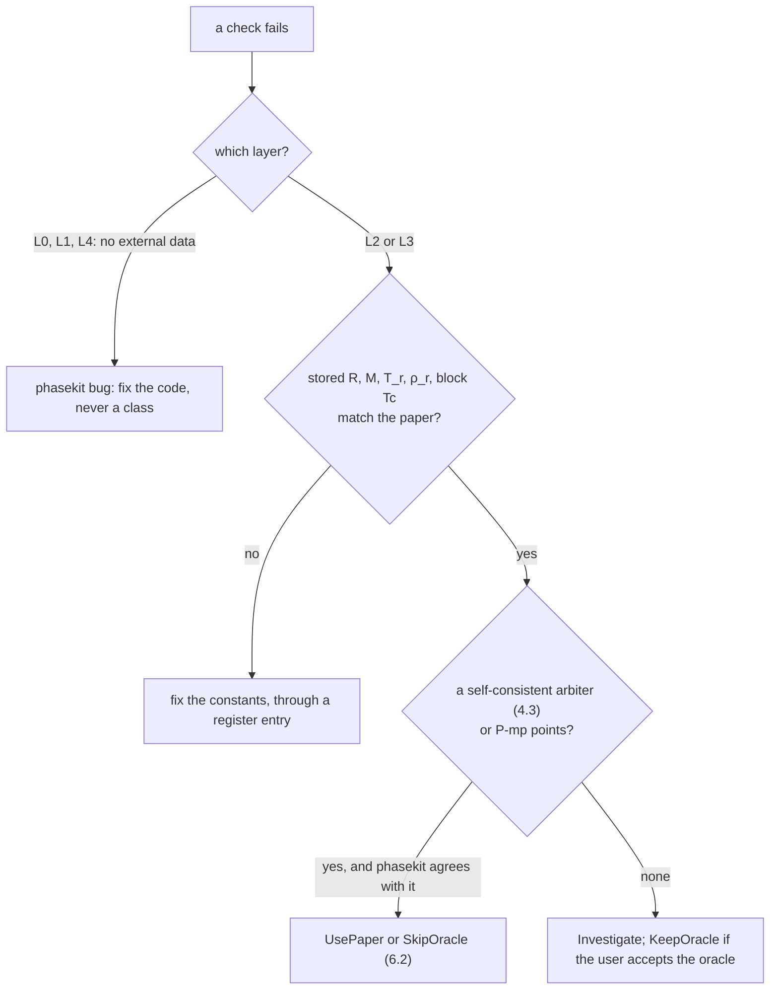
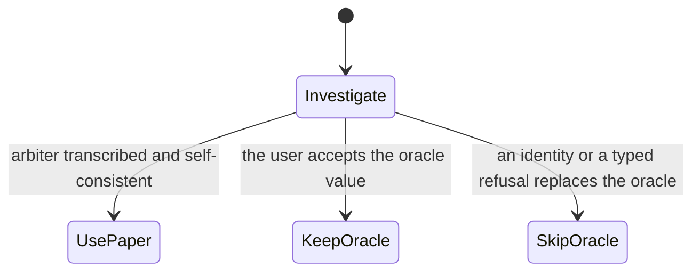

# phasekit verification

**Status:** living. The verification specification (D13): the `phasekit-verify` kit and corpus,
`scripts/oracle/gen.py`, `cargo xtask {oracle,gates}`, CI and the benches. It refines
[ARCHITECTURE.md](ARCHITECTURE.md) and reverses none of its decisions; [DECISIONS.md](DECISIONS.md) overrides anything
older; *(decision)* marks what it settles.
Where each fact lives and the citation forms: [PLAN.md §2.1](PLAN.md#21-ids-and-references). "Measured 2026-10-05"
marks oracle runs made for this document (CoolProp 8.0.0 wheel, `.so` sha256 `05d85591…089be5`).

## 1. Principles

1. **The scalar `f64` reference path is phasekit's specification.** Batch, threads and later SIMD lanes prove bitwise
   equality with it (section 9). Bitwise asserts only within one code path (map 10 R16).
2. **CoolProp 8.0.0 is a provisional oracle.** Its outputs depend on 38 global config keys and hidden environment
   switches (map 10 §4), and it is wrong in known places (map 10 §8.4, map 12 §6.3). It catches our mistakes; it
   cannot certify itself. Its fixtures come from x86-64 Linux only and are never asserted bitwise (K18).
3. **Printed literature arbitrates** (computer-verification tables, IAPWS releases; map 13 §1); multiprecision values
   arbitrate saturation of a given EOS (map 09 §8). A table arbitrates only after it reproduces with its own stated
   constants (section 4.3); NIST IR 8474 fails that test (map 13 §3).
4. **Tolerances derive from provenance** (printed digits, a solver's stopping rule, measured conditioning) and live in
   one class table (section 5). They are never widened to make CoolProp pass (map 10 R4, R5): a disagreement becomes a
   cited register entry with proofs (section 6), never a looser bound or an edited fixture. Every expected value carries
   its provenance (4.1); self-referential values and other implementations never arbitrate (map 10 R6).
5. **Fail closed, assert strongly.** Zero tests run, a missing or unparsable fixture, an unknown header key, a manifest
   mismatch, an unknown DIV id, a bare `#[ignore]`, a register entry without its proof: each fails, none skips (map 10
   R1, R2, R14, R15; map 12 R17). A round trip asserts recovered values against a class, never only "no error" or
   "finite" (map 10 R3); `Smoke` is only for the robustness corpus.
6. **Tests share nothing mutable.** nextest runs each test in its own process and `cargo test` runs them on parallel
   threads, so neither order nor a shared process may matter; models are immutable (map 10 §7). The only
   global state is CoolProp's, inside the generator, which builds a fresh state per case.
7. **TDD by capability.** Failing tests first, then code; unreached capabilities return typed errors, so every
   milestone ends green (D15). `phasekit-verify` depends on core, never the reverse (D1).

## 2. Layers of truth (L0-L6)

Map 10 §8.5's L1-L5 (term, EOS, saturation, flash, transport) all sit in L1-L4 here.

| Layer | Unit under test | Seam | Truth (priority order) | Classes | First | Where |
|---|---|---|---|---|---|---|
| L0 unit values | newtypes, `math`, `powi` chain, `Jet4`, δ-factor polynomials, FNV-1a, fixture reader | private functions | hand derivations; literal vectors (FNV self-test `8e75626511d00b5c`, map 10 §3) | `Exact`, `Term` | M0 | `#[cfg(test)]` per crate |
| L1 two derivative mechanisms | every term kind, value and all A_ij to order 4 | `accumulate` vs `Jet4` vs num-dual AD of the paper formula | AD; oracle block isolation (L3) second | `Term` | M3 | core unit tests; `tests/terms.rs` |
| L2 printed tables | compiled record: EOS, α⁰, transport, σ, melting | `FluidRecord` → `compile` → rows | self-consistent paper, IAPWS, P-mp rows (section 4) | `Paper`, `SatMp`, `SaFit`, `Measured` | M4 | `tests/arbiters.rs` |
| L3 oracle fixtures | everything CoolProp computes, on `DataSet::Parity` | fixture kinds (3.5) | CoolProp 8.0.0 (provisional) | per column | M2 | one test file per kind (`tests/oracle_term.rs`, `tests/eos.rs`, `tests/sat.rs`, …) |
| L4 identities, round trips | relations, partials, gauge, flash, saturation equilibrium, virials, capability matrix | `State`, `relations`, `Fluid::with_gauge` | identities; no data | `Identity`, `Fd`, `Flash`, `Exact` | M5 | `tests/eos.rs` (`identities_hold` at the `eos` grid, M5.1), `tests/{flash,capability}.rs`; conformance kit |
| L5 nightly sweeps | L3 + L4 over 136 fluids, all pairs, full grids | `--ignored` | as L3, L4 | as L3, L4 | M1 (drift check), M3 on (sweeps) | `tests/sweeps.rs` |
| L6 execution | every `ExecPolicy`, 1..N threads, batch vs scalar, later lanes | `batch::evaluate`, `policy_equivalence` | the `Reference` scalar path | `Exact` | M1; rayon M9 | `tests/batch.rs`; the kit's `policy_equivalence` (`tests/new_family.rs`) |

**When sources disagree** (the full path, from failing test to proof: 6.4):



P-mp points arbitrate saturation of the same EOS only, never its coefficients (map 09 §8). Independent evaluations
localise a fault but never arbitrate: mpmath on the JSON coefficients (map 02 §8; map 10 §8.5 step 2), teqp or
Clapeyron (`OtherImplementation`), REFPROP out of process (map 07; never in CI). Self-referential values
(CoolProp-computed "reference" rows, map 10 R6; Air and Neon melting, map 10 §8.1) are not used.

## 3. Oracle: CoolProp 8.0.0 fixtures

### 3.1 Generator and invocation

`scripts/oracle/gen.py`: one file, stdlib + `CoolProp` only (no numpy), so the uv environment is exactly the pinned
wheel. `cargo xtask oracle` drives it (alias `xtask = "run --quiet -p phasekit-xtask --"` in `.cargo/config.toml`). xtask builds
the environment from nothing (passing `UV_CACHE_DIR` through if set) and runs exactly:

```sh
env -i PATH="$PATH" HOME="$HOME" LC_ALL=C TZ=UTC PYTHONHASHSEED=0 PYTHONDONTWRITEBYTECODE=1 \
  uv run --no-project --python 3.12 --with CoolProp==8.0.0 \
  python scripts/oracle/gen.py --lock crates/phasekit-verify/fixtures/oracle.lock \
    --kind eos --tier core --out crates/phasekit-verify/fixtures/coolprop-8.0.0 --jobs 0
```

CLI: `--kind {facts,checkpoints,term,eos,crit,sat,flash,transport,sigma,melt,refstate,props,codes}`, `--set S` (the
`facts` set: `smoke`, `register`), `--tier {core|all|full}` (the committed core subset, the committed all-fluid tier,
or the nightly full set; 3.6), `--fluids <a>,<b>` (a subset of the tier), `--rows N` (override of the tier's grid,
3.5), `--seed S` (default 1), `--jobs J` (0 = one per core), `--out DIR`, `--check` (generate to a temp dir, compare
bytes with `DIR`, exit 1 on any difference), `--write-manifest` (rewrite the `MANIFEST.sha256` lines of the files
written). A kind is added to gen.py in the PLAN.md step that first uses it, and its committed files and manifest lines
land in that step's PR. Files are written to a temp name and renamed; nothing is written under `reference/`.

**Start-up assertions** (any failure exits non-zero before a row is computed):
1. Before `import CoolProp`: no environment variable starts with `COOLPROP_` or `PXFLASH_`, and `LC_ALL == "C"`. This
   covers the load-time switches the config system cannot reset (`COOLPROP_DISABLE_SUPERANCILLARIES_ENTIRELY`,
   `…_SUPERANC_HSU_D`, `…_MELTING_CALORIC_HS`, `…_SUPERANC_HS`, `PXFLASH_DIRECT_EOS`, `PXFLASH_INNER_NEWTON`;
   map 10 §4).
2. After import: `__version__ == "8.0.0"`; `__gitrevision__` and the sha256 of `CoolProp.abi3.so` equal the lock;
   `len(FluidsList()) == 136` (map 10 U2).
3. All 38 config keys are set explicitly to the lock's values (`set_config_*`, map 10 U2); `get_config_as_json_string()`
   must then parse equal to the lock's `config_json`.
4. Per fluid, `json.loads(get_fluid_param_string(f, "JSON"))[0]` equals the parsed
   `reference/CoolProp/dev/fluids/<file>.json` (the oracle's data is the repo data, map 10 §4); its sha256 goes in the
   header.
5. The SplitMix64 golden vector (first 4 outputs, seed 1) matches `phasekit_verify::sample`; both sides test it.

**Per case:** a fresh `AbstractState("HEOS", fluid)` per row (map 03 §8; `specify_phase` is sticky, map 01 R12; about
49 µs each, map 10 §5). Reference state `DEF`; only the `refstate` kind calls `set_reference_state` (global, mutating;
map 10 §4, map 15 §8), one child process per reference state. `term` isolates blocks with `add_fluids_as_JSON` on a
renamed one-block clone (map 10 §8.2), only in generator children. A `fork` process pool (children inherit the loaded
library; 5.9× on 6 cores, map 10 §7) computes rows by index and writes them sorted, so bytes do not depend on `--jobs`.
An exception becomes `status = err:<class>`, and so does a call that reports failure only through CoolProp's process-wide `errstring` (`Props1SI` returns `inf` and sets it; gen.py clears it before each call and reads it after, M1.3); the class comes from a fixed message table: `notimpl` (not available or not
implemented), `solver` (iterations, no solution, solver failed), `domain` (out of range, "must be", outside), `other`.
Messages are not stored *(decision)*: they differ between scalar and vector paths (map 14 §10) and contain commas. NaN
is canonicalised and written `nan`; ±∞ as `inf`, `-inf`.

### 3.2 `oracle.lock`

`crates/phasekit-verify/fixtures/oracle.lock` pins the oracle's environment: line-oriented `key value` text
*(decision)*, so gen.py, xtask and the kit (via `include_str!`, to check fixture headers) read it without a parser
dependency. It records the CoolProp version and git commit, the wheel tag and the `.so`'s name, size and sha256, the
Python minor version and platform, the nightly `runner_image` by digest, the `uv` command, `fluids_sha256` (the hash
of `data/fluids.lock`'s lines), the sampler, the scrubbed environment, the locale and all 38 config keys. Editing any
line is an oracle-pin move (6.5).

The lock pins the environment only *(decision)*: gen.py's sha256 goes into each fixture header (`# generator:`), so
adding or changing a kind regenerates the affected fixtures but never edits the lock; the fastchebpure pin lives with
its per-file sha256 lines in `mp/fastchebpure.lock`. Python's patch version and the host libc go into each fixture
header, not the lock: the `.so` calls the host libm, so another glibc may move last bits *(inference)*, which is why
nightly regeneration runs in the pinned `runner_image`.

### 3.3 Fixture file format (`<kind>/v1`)

```text
# fixture: eos/v1
# oracle: CoolProp 8.0.0 git=ae81610e7d23efc57f9d051c8e70a4d66e87537f so_sha256=05d85591...
# generator: gen.py sha256=... python=3.12.<patch> libc=glibc-<version>
# config: {... the 38 keys as set ...}
# env: scrubbed COOLPROP_* PXFLASH_*; LC_ALL=C
# fluid: Water json_sha256=...
# grid: T~U[Tlow,Tmax] rho~logU[1e-06*rhoL(Tlow),rhoL(Tlow)] Tlow=max(Tmin,Ttriple) n=500 seed=1 phase=imposed:gas
# source: coolprop
# columns: T,rhomolar,region,status,p,hmolar,smolar,umolar,cvmolar,cpmolar,speed_sound,Z,...
# units: K,mol/m3,-,-,Pa,J/mol,J/mol/K,J/mol,J/mol/K,J/mol/K,m/s,-,...
# tol: in,in,label,label,prop,prop,prop,prop,prop,prop,prop,prop,...
# bits: fnv1a64=0123456789abcdef
300,55000.12,stable,ok,...
```

Rules, all enforced by `phasekit_verify::fixture` (a violation is an error):
- UTF-8, LF, no quoting, no commas inside cells. Header lines are `# key: value` in the order above. `fixture`,
  `source`, `columns`, `tol` are always required; `oracle`, `generator`, `config`, `env`, `fluid`, `bits` too when
  `source: coolprop`. Unknown or duplicate keys fail. No separate CSV header row; every row has exactly `columns` cells.
- Floats are Python `repr` (shortest round trip); Rust `str::parse::<f64>` is correctly rounded, so every finite value
  is bit-exact (map 10 §8.3, measured for all finite values). Tokens: `nan`, `inf`, `-inf`.
- `bits:` is FNV-1a 64 (offset `0xcbf29ce484222325`, prime `0x100000001b3`, map 10 §3) over the little-endian IEEE
  bits of every float cell in row order, `nan` as `0x7ff8000000000000`. gen.py computes it with `struct.pack('<d')`;
  the kit recomputes it after parsing. This is the M1 "fixture round trip bit-exact" gate.
- `status` is per row: `ok` or `err:<class>`. A `nan` output in an `ok` row means "no number from the oracle" (e.g. w
  at an unstable state; 4.3 % of a Water grid, map 10 §5).
- `tol` names a section 5 class per column (`in` = input, `label` = compared as text: `region` ∈ {stable, metastable,
  unstable}, `phase` in CoolProp's names, `path` ∈ {superanc, vle, ancillary, crit_spline}; map 10 §8.3). Tests take
  tolerances only from here or from a register entry; no tolerance literal appears in a test *(decision)*.
- `.gitattributes` marks `crates/phasekit-verify/fixtures/** -text`, so Windows checkouts keep the hashed bytes
  *(inference: autocrlf would rewrite them)*.
- `source:` → `Provenance`: `coolprop` → `Oracle`; `paper:<bibkey>/<table>` → `Paper`; `iapws:<release>/<table>` →
  `Iapws`; `mp:coolprop-json`, `mp:fastchebpure@<tag>` → `MultiPrecision`; `coolprop-source:<path>@<git>` (names
  and codes read from the reference sources, e.g. the pair-name table of `src/DataStructures.cpp`) → `Oracle`.

### 3.4 Layout and naming

```text
crates/phasekit-verify/
  fixtures/                                   committed; read with include_str!, so the corpus runs on wasip2
    oracle.lock
    MANIFEST.sha256                           "<sha256> <bytes> <rows> <path>" for every COMMITTED fixture
    coolprop-8.0.0/<kind>/<Fluid>.csv         core subset (14 fluids, 3.6)
    coolprop-8.0.0/all/<kind>.csv             all-fluid tier: a leading `fluid` column, a few rows per fluid (3.6)
    coolprop-8.0.0/facts/<set>.csv            named oracle facts: `smoke`, `register` (3.5)
    paper/<Fluid>/<bibkey>.<table>.csv        transcribed check tables (4.2)
    paper/<Fluid>/<bibkey>.<table>.check.csv  the independent second transcription (4.2)
    mp/check-points.csv                       the 390 superancillary check points (3 x 130 fluids, 62 kB)
    mp/fastchebpure.lock                      release tag, zip sha256, per-file sha256 (PLAN.md M6.1)
    mp/fastchebpure-2026.06.02-v2/<Fluid>.csv dense outputcheck data, core fluids
    hash/                                     cross-target hashes (9.4)
  fixtures-full/                              gitignored: the nightly full set, same tree under coolprop-8.0.0/
```

`<Fluid>` is CoolProp's canonical name (`R1234ze(E)`); characters outside `[A-Za-z0-9._()-]` are percent-encoded
*(decision)*. `MANIFEST.sha256` lists the committed fixtures only; `cargo xtask oracle --write-manifest` rewrites the
lines of the files it writes, in the PR that changes them, and `gates fixtures` checks every line per PR. The full set
has no manifest *(decision)*: the nightly regenerates it, uses it and discards it, and detects oracle drift through
the committed files instead (3.6). Tests reach the full set through `concat!(env!("CARGO_MANIFEST_DIR"),
"/fixtures-full")` (compile-time; clippy bans run-time env reads, D17); a missing full set fails the nightly tests,
never skips them.

### 3.5 Kinds, columns and grids

| Kind | Columns after the inputs | Grid: core / all-fluid tier / nightly | First (PLAN.md step) | Compared with |
|---|---|---|---|---|
| `facts` | `name, call, status, value`: one named oracle fact per row, `call` written as `PropsSI(H;T;300;Q;1;R134a)` because cells hold no commas; a call is `PropsSI`, `Props1SI` or `AbstractState(backend;fluids;[pair;v1;v2;]method;args…)`, one method on a state (`melting_line`, `d2alphar_dDelta2`) (`set` = `smoke`: the R134a QT enthalpy, Water `Tcrit` and `T_reducing`; `set` = `register`: every value a register entry cites) | one file per set | M1.3, M1.13 | `Exact` (bit-exact parse of what the oracle printed) |
| `checkpoints` | `fluid, Tc, T, p, rhoL, rhoV, p_sa_mp, rhoL_sa_mp, rhoV_sa_mp` from `EOS[0].SUPERANCILLARY` (`check_points`, and `meta` `Tcrittrue / K`, the T_c of Θ = (T_c − T)/T_c), source `mp:coolprop-json` (written to `mp/check-points.csv`); the SA/mp ratios set each point's `SaFit` bound. Points sit near Θ = 0.5, 0.3, 0.1 (fastchebpure's grid); one below the triple point moves up to it. T, ρ′ and ρ″ are multiprecision, p is not: it carries a double-precision liquid side's rounding (up to 3.7e-9 at Θ = 0.5), so the VLE is compared with the vapour side's p at the point's (T, ρ″) (user decision DP1, measured at M6.3) | 390 rows (all SA fluids) | M1.17 | `SaFit` (SA), `SatMp` (VLE) |
| `term` | `block_idx` (a block index in `EOS[0].alphar`, `all` for the α^r total, `ideal` for the α⁰ total), `block_type` (the JSON type without `ResidualHelmholtz`), `terms` (the block's term count: datagen merges Power and Exponential blocks into one power list in file order, so a test finds a block's terms by it), the inputs `T, rhomolar` and the `tau, delta` CoolProp then holds, `status`, `alphar` + 14 α^r derivatives to order 4, unscaled, in `AbstractState`'s method order (α⁰ to order 3: the oracle exposes no 4th, map 10 §8.2) | δ ~ logU[1e-8, ρ_max/ρ_r] (ρ_max: saturated liquid at the minimum temperature, the record's density bound), τ ~ U[T_r/Tmax, T_r/Tmin], one set of points per fluid shared by all its blocks, each row evaluated at T = T_r/τ, ρ = δρ_r with the phase imposed; NonAnalytic blocks add 20 points with \|τ − 1\|, \|δ − 1\| ~ logU[1e-6, 1e-2] (map 10 §8.5); total rows (`block_idx = block_type = all`, `terms` the fluid's residual term count) evaluate the fluid itself at the first points of the same grid, each with an α⁰ row at the same point (`block_idx = block_type = ideal`, `terms` its α⁰ block count, the order-4 columns `nan`; M4.3): 100 per block / 4 total rows per fluid (`all/term.csv`, a leading `fluid` column) / 300 per block + 64 total rows per fluid (`term/<Fluid>.csv` of the full set, read by `tests/sweeps.rs`) | M3.1 (blocks), M3.6 (totals), M4.3 (α⁰) | `Term` (section 5) on A_ij = τ^i δ^j ∂^(i+j)α, never on the unscaled derivative relative to itself: CoolProp divides by δ^j, so at δ = 1.8e-8 its ∂⁴α^r/∂δ⁴ for Air's Power block is 7.8e6 where the exact value is 5.18, a difference of 1e-15 of that entry's `Term` scale (measured at M3.1) |
| `eos` | `region, status, p, h, s, u, cv, cp, w, Z, dpdrho_T, dpdT_rho, Bvirial, Cvirial, dBvirial_dT, dCvirial_dT` and the partial, `cp0molar` and residual columns (molar SI); since M7.10 ten second partials (`second_partial_deriv` over the ten variables it differentiates twice), `fundamental_derivative`, `isothermal_compressibility` and `isobaric_expansion` | T ~ U[T_low, Tmax], ρ ~ logU[1e-6·ρL(T_low), ρL(T_low)], phase imposed (gas), T_low = max(Tmin, Ttriple) (map 09 R8); `region` from the oracle's QT densities at T, or its saturated-density ancillary where QT finds no root (pseudo-pure fluids within about 2 K of Tc): 500 / 8 / 10,000 | M5.1, M5.5, M7.10 | `Prop` (with `Term` carried through the relation, §5) |
| `cubic` | `fluid, kind, T, rhomolar, status` and `alphar`, A10, A01, A20, A11, A02 (A_ij = τ^i δ^j ∂^(i+j)α^r from the oracle's τ and δ), `p, hmolar, umolar, gibbsmolar, helmholtzmolar, cvmolar, cpmolar, speed_sound, cp0molar`; never entropy (DIV-0010; map 06 §8) | SRK and PR (c = 0) for every fluid v8.0.0's cubic library has: T ∈ {1.05, 1.5}·T_c, ρ ∈ {0.05, 0.5, 1, 1.8}·p_c/(Z_c R T_c), with the library's T_c and p_c: — / 1856 rows in `all/cubic.csv` (116 fluids) / — | M11.4 | 1e-12 relative, h, u, g and a to RT (map 06 §10 Q9); DIV-0048 and DIV-0049 exempt the fluids whose library data drifted |
| `cubic_sat` | `fluid, kind, T, status, p, rhoL, rhoV`: v8.0.0's cubic superancillary through `saturation_ancillary` (map 06 U4) | SRK and PR for every fluid v8.0.0's cubic library has at T ∈ {0.3, 0.5, 0.7, 0.9, 0.99}·T_c (the library's): — / 1160 rows in `all/cubic_sat.csv` / — | M11.5 | ρ′ 1e-13, p and ρ″ 2e-12 (exponential in T̃ at low T); DIV-0048's fluids exempt |
| `crit` | `Tc_pub, pc_pub, rhoc_pub` (SA off), `Tc_num, pc_num, rhoc_num` (SA on), `Ttriple, ptriple, Tmin, Tmax, pmax, M, R`; `Ttriple` and `ptriple` are CoolProp's, i.e. the saturation minimum (map 09 R8), not the record's triple point; the all-fluid tier adds a leading `fluid` column | 1 / 1 / 1 | M2.3 published, M6.7 numerical | `Exact` (data constants); `Flash` (numerical point) |
| `sat` | `input, Q, T, p, rhoL, rhoV, hL, hV, sL, sV, path`; `input` ∈ {T, p, `sa`}: `sa` rows come straight from `CP.SuperAncillary(json).eval_sat` (p, ρ′, ρ″; map 03 §8) | Θ = 1 − T/Tc log-spaced 1e-7 … 1 − Tt/Tc (Tt, Tc the superancillary's range), Q ∈ {0, 1}, T and p inputs, a PQ row's p the QT row's at its temperature: 100 (25 T, QT and PQ at both Q) / 8 `sa` + 8 QT (Q = 0) + 8 PQ (Q = 1) / 600 (200 T, as the all-fluid tier); M5.2 writes `sa` rows to `all/sat.csv` and the full set, M5.2a a QT row at Q = 0 at each `sa` temperature, M6.8 the PQ rows and the core files. A PQ row's T, ρ and h, s cells are DIV-0018's: they are checked against the QT row that gave the row its p (user decision PQ1). Pseudo-pure (M6.9; path `ancillary`): Θ = 1 − T/T_max log-spaced 1e-3 … 1 − T_min/T_max over QT's range, QT at Q ∈ {0, 1} (only the side Q names: CoolProp computes no other), PQ at Q ∈ {0, 0.5, 1} at the QT bubble pressure (none where the oracle's QT failed), checked as user decisions PP1, PP2 decide; the in-dome DT rows are the `flash` kind's `dome` truths | M5.2 (`sa`), M6.8, M6.9 | `SaCoeff` (`sa` and `superanc` rows), `Prop` (`ancillary` rows) |
| `flash` | `pair, x1, x2, truth, status, T, rho, p, h, s, u, Q, phase` (truth PT, QT or `dome`; x1, x2 the pair's inputs: DT ρ, T; PT p, T) | truth states on (log p, T) and (T, Q) grids, read off as the DT and PT pairs (the other pairs are round trips, `tests/flash.rs`), never density bands (map 12 §6.4): 6×6 + 4×4 / the six pseudo-pure fluids' 4×4 `dome` truths (`all/flash.csv`) / 40×40 + 20×20 (map 10 §2.3); CoolProp has no QT at 0 < Q < 1 for a pseudo-pure fluid, so its (T, Q) cells are `dome` truths, (ρ, T) with ρ between its QT densities at Q = 0 and 1 (M6.9). A PT truth's PT row (M7.1) is the truth itself, CoolProp's PT flash of its own inputs, ρ an output too; its p, h, s and u are DIV-0020's | M5.3 (DT), M6.9 (`dome`), M7.1 (PT) on | `Flash` |
| `transport` | `T, rho, phase, eta_status, eta, eta_{dilute,initial_density,residual,critical}, lambda_status, lambda, lambda_{dilute,initial_density,residual,critical}, eta_model, lambda_model` (models: staged, ecs, rhosr, chung, hardcoded, none; the stages are CoolProp's `*_contributions`, which put a whole model's total under `critical`, map 05 R8) | stable single phase only (map 10 §8.5): T uniform, log p uniform, ρ from the PT flash, transport at DT(ρ, T): 200 / 8 / 5,000; `--set probes` adds fixed DT states for the branches no random state reaches (M8.6: Methane's ancillary and near-critical χ, 13 states; M8.9: Helium's critical term, 13 states) | M8.5 | `TransportDirect` / `TransportEcs` by model |
| `sigma` | `T, status, sigma` | 50 / 4 / 500 over the fitted range | M8.4 | `Prop` |
| `melt` | `input, T, p, status` | 50 / 4 / 500 per segment | M8.11 | `Prop` |
| `refstate` | `refstate, role, pair, x1, x2, status, h_mass, s_mass`: per reference state (IIR, ASHRAE, NBP) its anchor (`role` = anchor; its own pair, QT or PQ) and saturated QT states, each set with `set_reference_state` and reset to DEF; a refused one is its anchor row with an error status | anchor + 20 per reference state (the core subset and n-Propane, R134a, R124, the fluids of `CoolProp-Tests.cpp:2263-2436`) / none / the core set | M10.1 | `Prop` at both the state and the anchor; anchors `RefAnchor` (1e-8 absolute, map 01 §8) against their definition |
| `props` | `pair, x1, x2, output, status, value`: the 85 outputs of map 01 §4a via `PropsSI` at DT and QT states, long format, and since M10.3 at the DT states the `eos` kind's 12 first and 10 second partials as derivative strings, then the 28 trivial ones via `Props1SI` (pair `Props1SI`) | per fluid half DT (T, ρ as `eos`, no phase imposed, drawn again where p > pmax), half QT (Q = 0, 0.5, 1), T above the EOS's own triple point: 10 / none / 200 states per fluid | M10.2 | per output (`tests/common/props_rows.rs`): `Prop` at max(\|value\|, floor), or `Term` carried through the relation (a derivative string's floors OD2's, a second partial's `Term` carried to order 3); `Flash` for what a state inside the dome takes from its saturation split; the `crit` kind's bounds for the critical point; η and λ in their model's class; trivial constants `Prop`, not `Exact` (map 01 §8: `Tcrit` 647.0959999999873) |
| `codes` | `codes/coolprop.csv`, `table, name, index`: parameter codes from `get_parameter_index` (every output and alias name, its upper-case form, and five names it refuses as -1), phase codes from `get_phase_index`, input-pair values from `CoolProp.constants`; `codes/pair-names.csv`, `name, pair`: `input_pair_list` of `src/DataStructures.cpp` in order, collisions included, with `coolprop-source:` provenance (the wheel exposes no `get_input_pair_index`; map 01 R2) | all / none / all | M10.6 | `Exact` (the shim's v8.0.0 codes, D11) |

SA-off saturation is never a fixture *(decision)*: near Tc it uses critical splines with errors up to 3.5 % (map 03
§8). EOS VLE is verified against P-mp instead (4.4, 7.4).

### 3.6 Committed core subset, all-fluid tier and nightly full set

This section is the one definition of the committed fluid set; PLAN.md §2.3 and ARCHITECTURE.md §10 link here. 14
fluids are committed at full core-grid density *(decision)*: map 13 §8's 10 (its answer to map 10 Q6) plus 4 for
proofs and block coverage. Every other fluid is reached per PR through the all-fluid tier below, so a fluid needs a
core-subset place only for dense or multi-block coverage, a divergence proof or a pseudo-pure rule. Budget: 16 MiB in total,
enforced by `gates fixtures`.

| Fluid | Why (map 13 §8 unless stated) |
|---|---|
| Water | NonAnalytic, Gaussian, PlanckEinstein; every IAPWS arbiter; DIV-0002, DIV-0012; critical `Undefined` (M4) |
| CarbonDioxide | second NonAnalytic set, EnthalpyEntropyOffset; η, λ paper rows; critical `Undefined` |
| R1234yf | Gaussian + PlanckEinstein; Lemmon & Akasaka 2022 Table 7 (6 states); mixtures at M13 |
| R1130(E) | Exponential with g ≠ 1; Huber et al. 2025 Table 4 (OA) |
| Helium | α⁰ only Lead + LogTau + EnthalpyEntropyOffset; quantum fluid; K3 rows; DIV-0005 |
| Ammonia | GaoB (only fluid) |
| R125 | Lemmon2005 (only fluid); α⁰ Power |
| Air | pseudo-pure; PlanckEinsteinGeneralized; η, λ rows |
| Nitrogen | PlanckEinsteinFunctionT; DIV-0003 |
| HFE143m | CP0Constant + CP0PolyT |
| R1234ze(E) | DIV-0001 exemplar (Thol 2016 Table 3, OA) |
| Methanol | DoubleExponential, oracle-only (map 13 §8 gap) |
| n-Heptane | CP0AlyLee, arbitrated by the closed-form c_p⁰ (map 13 §8 gap) |
| R410A | pseudo-pure with distinct bubble and dew points (E3; user decision 4) |

The subset covers all 17 block types in use (map 10 U3). The fluids of the Lemmon 2016 table (R227EA, R365MFC, R115,
R13I1) and HeavyWater need no core-subset place: their arbiters are paper rows (4.4), and the all-fluid tier carries
their oracle rows.

The **all-fluid tier** (`coolprop-8.0.0/all/<kind>.csv`, committed, run per PR on every platform) holds, for every
fluid that has the model: 4 `term` total rows each for α^r and α⁰, 1 `crit` row, 8 `eos` rows, 8 `sa` and 8 QT/PQ
`sat` rows, 8 `transport`, 4 `sigma` and 4 `melt` rows (grid column of 3.5). It catches per-fluid data and decoding
errors, which any state reveals; the dense grids stay nightly. Unpublished fluids (Propylene, SES36, Neon) appear only
as oracle rows, labelled (D14, map 13 R7).

The **nightly full set** (136 fluids × every kind × the nightly grid, about 3.5 GB raw, map 10 §8.3) is generated by
`cargo xtask oracle --tier full` in the pinned runner, used by the `--ignored` sweeps, and discarded. Before it, the
nightly regenerates the committed files twice: the first run must equal the repository bytes (else the oracle
environment drifted) and the second the first (else gen.py is non-deterministic); either failure stops the job before
any result is believed. Per PR, CI only re-hashes the committed files (no Python).

### 3.7 Licensing and provenance annotations

All three fixture kinds may be committed (user decision 3b; D14), each with provenance and a citation through REUSE 3.3
`REUSE.toml` annotations (dependencies §2.13). `reuse lint` is a gate (section 11); the full set is never committed.

| Path | SPDX-License-Identifier | SPDX-FileCopyrightText | Citation carried by |
|---|---|---|---|
| `coolprop-8.0.0/**`, `mp/check-points.csv`, `oracle.lock` | `MIT` | CoolProp's copyright line, verbatim from its v8.0.0 LICENSE | header `oracle:` line |
| `paper/**` | `MIT OR Apache-2.0` (the transcription) | phasekit contributors | header `citation:` (DOI or report, table, page); the cells are numerical facts *(inference: facts are not copyrightable; not legal advice)* |
| `mp/fastchebpure-*/**`, `mp/fastchebpure.lock` | `LicenseRef-fastchebpure`; its `LICENSES/` text records the user-decision-3a fact (no upstream licence file; NIST work generally not under US copyright, *inference*) and the NIST disclaimer | NIST (fastchebpure authors) | `source: mp:fastchebpure@2026.06.02-v2` + the superancillary paper in NOTICE |

## 4. Literature arbiters

### 4.1 What arbitrates

Strongest first (map 13 §1): (1) computer-verification tables and IAPWS releases: K1 α⁰/α^r and derivatives at one
(τ, δ), K2 (T, ρ) → p, c_v, c_p, w, K3 saturation rows; (2) printed correlation equations evaluated independently (c_p⁰,
σ with Mulero's own Tc, melting; map 13 §3); (3) printed property tables (lower precision); (4) the oracle only. P-mp
values (fastchebpure, the 390 check points) are exact for the EOS in T, ρ′ and ρ″: they arbitrate saturation, not
coefficients (map 10 §1). Their p is not: it carries a double-precision liquid side's rounding, so p is derived from
(T, ρ″) (user decision DP1, M6.3). `Provenance::is_arbiter()` is true only for `Paper`, `Iapws`, `MultiPrecision` (sketch `tolerance.rs`).

### 4.2 Transcribing a printed table

1. Download the paper anonymously into the gitignored `reference/papers/` (the fetch list is PLAN.md M1.8 and M8.2).
   Read the rendered page (PDF view or print), never PDF text extraction alone (map 12 §6.4). Confirm table numbers:
   map 13 §3 notes the IAPWS-95 table numbers 6 and 7 were from memory. A green-OA copy that is a PMC author
   manuscript is read from its JATS XML, fetched anonymously from the PMC Article Datasets
   (`https://pmc-oa-opendata.s3.amazonaws.com/<pmcid>.<ver>/<pmcid>.<ver>.xml`; the PMC PDF sits behind a browser
   proof-of-work; the Cloud Service is one of the routes PMC allows for automated retrieval). Each `<td>` holds one
   printed string, so this is no PDF text extraction; the XML has no pages, so the citation gives
   `manuscript=<pmcid>.<ver>` and `xml_sha256=` in place of `page=` and `pdf_sha256=` (PLAN.md M1.9). Such a file
   states "available for text mining … fair use" (PMC code `TDM`), not an open licence: it stays in
   `reference/papers/`, and committing its numbers rests on 3.7, not on that statement (user decision PS1).
2. Write `fixtures/paper/<Fluid>/<bibkey>.<table>.csv`:

```text
# fixture: paper/v1
# source: paper:Thol-IJT-2016-R1234zeE/Table3
# citation: doi=<doi> table=3 page=<page> erratum-checked=<date> pdf_sha256=<sha256 of the file read>
#   (a PMC author manuscript: doi=<doi> table=<n> manuscript=<pmcid>.<ver> erratum-checked=<date> xml_sha256=<sha256>)
# kind: K2
# constants: R=8.3144621 M=<as printed> Tc=<...> rhoc=<...> Tr=<...> rhor=<...>   (as printed, with units)
# transcribed: <who>; checked: <who>
# columns: T,rho,p,cv,cp,w
# units: K,mol/dm3,MPa,J/(mol K),J/(mol K),m/s
# tol: in,in,paper,paper,paper,paper
```

3. Cells keep the printed strings exactly, trailing zeros included: they set the tolerance. Digit-group spaces are
   dropped and `× 10ⁿ` is written `en`, so `0.996 556 0 × 10³` is `0.9965560e3` (PLAN.md M1.8); a release without a DOI
   cites `report=<id>` in place of `doi=`; `page=` is the printed page number, which can differ from the PDF's (NIST IR
   8474 page 16 is PDF page 22). The kit runs `from_printed` on the string (half a unit in the last printed digit, map
   13 §3), then converts value and bound to SI by `units`. An output cell left empty is a value the source does not give
   (`Cell::Blank`: R1234yf's ρ = 0 row has no p in CoolProp's comment, three papers print no c_v); an input cell is
   never empty. A `label` column `note` may follow the values; a note that names a divergence (`row 4 DIV-0014`) must
   name one registered for the file's fluid (`row_notes_cite_registered_divergences`).

   Rows a paper reaches us through CoolProp's own tests (map 10 §8.1, PLAN.md M1.12) are transcribed from
   `CoolProp-Tests.cpp` at v8.0.0: the citation gives `tests=src/Tests/CoolProp-Tests.cpp:<lines>@ae81610e` and
   `cpp_sha256=` in place of `page=` and `pdf_sha256=`, and the cells keep CoolProp's strings (SI literals such as
   `21.17909e6` Pa keep the paper's digits, so `from_printed` gives the paper's half unit). Where the paper is open, the
   row is re-checked on its rendered page and the citation adds that `page=` and `pdf_sha256=`, the header its
   constants.
4. Double entry *(decision)*: the second, independent transcription is committed beside the first as
   `<bibkey>.<table>.check.csv`, and the test `paper_tables_double_entry_agree` requires the two to match string for
   string, so the evidence stays checkable. The two are written by two agent sessions that cannot see each other's
   output (the second starts fresh in a separate worktree at the parent commit, with only the citation and the header
   template; PLAN.md M1.8), or by a person and an agent; a mismatch is settled by a third read of the rendered page.
   `checked:` names the second transcriber.
5. Record the paper's stated constants (R, M, T_r, ρ_r, the Tc of every block that has its own; map 13 R1 remedy) in
   the header and in `ARBITERS` (4.3).
6. Erratum check via the Crossref `updated-by` relation of the DOI (map 10 §8.4, map 12 R11), queried anonymously: no
   `mailto` polite-pool parameter and no personal identifier in any URL, header or payload. Never "fix" a paper value
   without a published erratum (map 10 §8.5 rule 3).

### 4.3 Self-consistency before a table arbitrates

`ARBITERS` (`phasekit-verify`, map 13 A1) holds one record per (fluid, part ∈ {α^r, α⁰, η, λ, σ, melting,
saturation}): citation {key, DOI or report, role}, table {file, kind, rows}, printed constants, and a status.

| Status | Meaning | Arbitrates? |
|---|---|---|
| `Expected` | a table is expected, not yet obtained (74 fluids, map 13 §1) | no |
| `Transcribed` | double-entered, not yet evaluated | no |
| `SelfConsistent` | every row within `Paper` with the paper's own constants | yes |
| `Inconsistent { residual }` | no constant set stated in the paper reproduces it; residual recorded | no: `Investigate` or `KeepOracle` |
| `None`, `Unpublished` | stated absent, or no paper (Propylene, SES36, Neon) | no; oracle-only fixtures |

Procedure (`tests/arbiters.rs`, on the mutable `FluidRecord` seam, ARCHITECTURE.md §3.8):
1. Decode under `Parity`; diff R, M, T_r, ρ_r and per-block Tc against the printed constants (map 13 §3 lesson: check
   these before blaming the evaluator). `stored_constants_match_their_arbiter_records` (M4.7) audits R, M, T_r and ρ_r
   of every record with transcribed constants (9 fluids) within half a unit of the last printed digit: a mismatch
   must be a registered `GasConstant` or `Reducing` divergence of that fluid, and the two found are pinned
   (R1234ze(E)'s R, DIV-0001; Helium's, DIV-0005). Map 13 R1's other 14 R candidates enter the register as
   `Investigate` only once a paper's printed R is transcribed; none is yet.
2. Set the paper's constants, `compile`, evaluate every row. All within `Paper` → `SelfConsistent`; otherwise
   `Inconsistent { residual }`. NIST IR 8474 Table 3 is 1.0e-6 to 1.4e-6 off with its own Table 1 R, so it cannot
   arbitrate (map 13 §3 item 4).
3. Evaluate with the v8.0.0 constants. Both pass → no divergence. Paper passes, v8.0.0 fails → `UsePaper` candidate
   (DIV-0001: ≤ 1.9e-7 with R = 8.3144621).
4. The test asserts the recorded status, so an arbiter cannot change category silently.

### 4.4 Core arbiter set

| Fluid / part | Arbiter | Kind | Status (map 13 unless stated) | Gate |
|---|---|---|---|---|
| Water α | IAPWS R6-95(2018) α table, 500 K, 838.025 kg/m³ ("Table 6") | K1 | oracle ≤ 2.9e-9; `SelfConsistent` at M4.5 (Tables 6 and 7, both constant sets) | M4 |
| Water properties | IAPWS-95 (T, ρ) table ("Table 7"), saturation table ("Table 8") | K2, K3 | ≤ 2.6e-9 (K2); Table 7 within its printed digits at M4.5 through `State::from_total`; Table 8 within its printed digits at M6.10 from the EOS's VLE, with both constant sets | M4.5 (Table 7), M6.10 (Table 8) |
| Water η, λ, melting, σ | IAPWS R12-08 Tables 4, 5; R15-11 Tables 4, 5; R14-08(2011) Table 3; R1-76(2014) Table 1, column (4) | rows | `Transcribed` at M8.2 (11 + 6, 4 + 8, 6 and 75 rows); η and λ `SelfConsistent` at M8.7, factor by factor with both constant sets (every cell within its printed digits, the worst at 0.97 and 0.99 of a half-unit); melting `SelfConsistent` at M8.11, its four ice Ih, III, V and VI rows within their printed digits under `Corrected` (its ice VII and sublimation rows lie outside v8.0.0's curve), and R14-08 decides DIV-0002; CoolProp's σ is Mulero 2012, so IAPWS σ is a separate labelled comparison (map 10 §8.4) | M8 |
| R227EA, R365MFC, R115, R13I1 | Lemmon et al. 2016 Table 7 (OA), 12 states | K2 | oracle ≤ 4.3e-7, within 7 digits | M5 |
| R1234ze(E) | Thol et al. 2016 Table 3 (OA) | K2 | DIV-0001 | M5 |
| Helium | NIST IR 8474 Tables 3, 4 (OA) | K2, K3 | `Inconsistent`; DIV-0005 at 5e-7 | M5, M6 |
| R1234yf | Lemmon & Akasaka 2022 Table 7 (6 states, in CoolProp's tests) | K2 | part of the 18 CoolProp test states, of whose 68 values 67 are within half a digit (map 10 §8.1) | M5 |
| 12 one-row fluids (R1130(E) among them) | `CoolProp-Tests.cpp:4798-4815` rows (map 10 §8.1), re-checked against the papers where obtainable | K2 | R1224YDZ p fails (DIV-0014) | M5 |
| HeavyWater | IAPWS R16-17; IAPWS R4-84(2007) Tables A5, B4 (D2O transport); Herrig 2018 Sec. 3.4 melting | K1/K2, rows | α `Expected`; η, λ and melting `Transcribed` at M8.2 (27, 31 and 4 rows); η and λ `SelfConsistent` at M8.7 (every cell within its ten decimals); melting `SelfConsistent` at M8.11 (its four rows to their nine digits, both data sets) | M5, M8 |
| Ammonia, CO₂, R125, Air, Nitrogen, HFE143m | Gao 2023; Span & Wagner 1996; Lemmon & Jacobsen 2005; Lemmon 2000; Span 2000; Akasaka 2012 | K2 | `Expected`: paywalled, the user supplies them (map 13 §10 Q1; PLAN.md section 6) | when obtained |
| n-Heptane, D6 α⁰ | Jaeschke & Schley 1995 closed-form c_p⁰ | equation | no table needed | M4 |
| 130 SA fluids | P-mp check points (Θ = 0.5, 0.3, 0.1), fastchebpure dense files | K3 (mp) | SA vs mp: p median 4.8e-14, max 4.7e-9 (map 10 §8.1) | M5 SA, M6 VLE |
| Transport, 40 fluids | the 318 `CoolProp-Tests.cpp` rows re-labelled (`paper/<Fluid>/CoolProp-Tests.{eta,lambda}.csv`, M8.3): only `paper` and `iapws` rows arbitrate, never Helium's (ROT-124); `refprop`, `self`, `experiment` and unsourced rows do not (map 13 §8, map 10 R6) | rows | median 7.8e-6 vs oracle; 262 arbiter rows over 56 fluid-property pairs | M8 |
| Helium λ | NIST TN 1334 (rev. 1998) Appendix B (OA): the 54 single-phase rows of 5-6.5 K on the 0.2-0.4 MPa isobars, Hands and Arp 1981 on TN 1334's own EOS and η | rows | `Inconsistent` (1.1e-2); DIV-0035's replacing check, within its measured 1.2e-2 | HE1 |

`phasekit_verify::arbiters::ARBITERS` (PLAN.md M1.7) holds these rows as records, all `Expected` or `Unpublished`
at M1 until their tables are transcribed; the 12 one-row fluids join at M1.12, the n-Heptane and D6 c_p⁰ equation checks
with M4, the transport rows and releases with M8.2, the mp check points with M1.17. No milestone gate depends on a
paywalled paper: every D15 gate names an open arbiter (IAPWS, Lemmon 2016, Thol 2016,
NIST IR 8474, mp points). Fluids without a usable arbiter stay oracle-verified (provisional); `ARBITERS` records each fluid's status.

## 5. Tolerance classes

Relative unless marked abs: |a − b| ≤ x · scale, scale = max(|b|, floor). Floors *(decision)*: molar energies (h, u, g,
a) R·T; entropies and heat capacities R; first partials ∂X/∂Y |X|/|Y| at the state; second partials (∂/∂W (∂X/∂Y)_Z)_V
|X|/(|Y|·|W|), the fundamental derivative 1, κ_T 1/|p|, β 1/T (user decision OD2); α values Σ_k |φ_k|. For a scaled
derivative A_ij the φ_k are the summands of its expansion by the product and chain rules, every falling factorial
written out, so Σ_k |φ_k| bounds the rounding of any evaluation order and is Σ_k |φ_k| of the terms for A_00
(`phasekit_verify::majorant`; PLAN.md M3.1). The plain Σ_k |φ_k| of the terms cannot bound a derivative: the
τ⁴-derivative of a term with t = 50 carries 50·49·48·47 ≈ 5.5e6, and Water's Power block misses it by up to 1.5e5 times,
while the expansion scale leaves every Power block of the core subset at headroom ≤ 0.03. The floor applies in the units
of each entry and to α itself: when Σ_k |φ_k| of α is below 1e-300 the terms' values, and every entry built from them,
pass through subnormal numbers, so each entry's scale is raised by the same factor 1e-300 / Σ_k |φ_k|
(`majorant::floored`), and an entry is never compared below the floor in its scaled form A_ij (M4.1: far from the
critical point Water's non-analytic terms underflow, e^(−700(τ − 1)²) ≈ 1e-300). Non-separable terms take their scale
from the formula evaluated in majorant arithmetic (`majorant::Bound`: every sum and product taken on absolute values,
every composed function's derivatives at the true value). "nc" is the near-critical window |T/Tc − 1| < 1e-3 and |ρ/ρc −
1| < 0.1, published Tc, ρc (map 10 §8.3).

A `Prop` output X that a relation computes from the order-2 bundle (p, h, s, u, c_v, c_p, w, Z, the first partials, κ_T,
β), or from the order-3 one (the second partials, the fundamental derivative; user decision OD2, M7.10, over the ten
entries to order 3), also passes within `Term`'s bound on its *carried* scale Σ_ij |∂X/∂A_ij|·M_ij, where M_ij is the
`Term` scale of entry A_ij (Σ_k |φ_k| of the residual terms plus the ideal part's; `phasekit_verify::eos::carried`),
whichever bound is larger *(decision, M5.1, user-approved)*. It is the difference that two evaluations which each meet
`Term` can show in X, to first order. Like `Identity`'s largest term it measures conditioning (principle 4); it holds
for any code, the literature arbiters' included; it cannot hide a wrong term, which `Term` itself catches block by
block; and where a relation is well conditioned the strict bound is the larger one (89 % of the M5.1 nightly entries,
and 99 % lie within 15× of it).

| Class | Bound | Applies to | Derivation |
|---|---|---|---|
| `Exact` | bitwise (`to_bits`), statuses equal | executors, threads, batch vs scalar; gauge-invariant outputs; data constants (M, R, published Tc); fixture parse (`bits:`); `libm` cross-target hash | same code path, same operations; Rust neither contracts nor reorders (K12, map 10 R16) |
| `Term` | 1e-13 · Σ_k abs(φ_k), floor 1e-300 | α terms and A_ij vs oracle block isolation; `accumulate` vs `Jet4`/num-dual | sum-of-blocks vs total ≤ 2.2e-13 near critical (map 10 §8.2); 1-3 ulp FMA/libm (map 10 R16); 1e-13 is about 450 ulp of the expansion scale above; core-subset blocks vs the oracle (M3.1-M3.5): headroom ≤ 0.04 for every kind but Gaussian, 0.36 there, from contributions near 1e-141 whose exponent (\|u\| ≈ 320) rounds to \|u\|·ulp; α^r totals of 134 fluids 0.02 (M3.6); non-analytic blocks 0.006 (M4.1) |
| `Prop` | 1e-12; nc 1e-8; or `Term` carried through the relation, if larger | properties at (T, ρ), ancillaries, σ, melting vs oracle | cancellation near critical in c_p, w (map 10 §8.3); where a relation cancels, two evaluations agree only as far as their α derivatives do (principle 4, measured conditioning). M5.1: 7 of 80,880 per-PR entries and 584 of 13.5 M nightly ones (Z ≈ 1e-4, next to a spinodal, deep metastable liquid such as R22 at 130 K and −138 MPa) missed 1e-12 by up to 127×; with the carried `Term` bound none fails, headroom 0.036 |
| `SaCoeff` | 1e-14 | Rust Clenshaw vs oracle SA at the same input | same Chebyshev coefficients (map 10 §8.3) |
| `SaFit` | 4 · abs(SA/mp − 1) of that point, floor 1e-14 | SA vs P-mp points | CoolProp's own acceptance rule (map 10 §3) |
| `CaloricFit` | 2e-6 of max(abs(value), floor) | caloric curves vs the EOS at (T, ρ_SA(T)) between nodes | measured: the worst of 130 fluids is 1.1e-6, in the last piece below Tc, where h, s, u go like (Tc − T)^β; rounded up to one significant digit. The curves are starting points that M7.7 and M7.8 polish with the EOS (user decision CC2) |
| `SatMp` | ρ max(1e-11, 4·ε·Θ^−1.5·μ); p, T max(1e-11, 4·ε·μ/Θ); Θ = (Tc − T)/Tc, μ the carried `Term` scale of g | Rust VLE vs P-mp; rescaled SA vs VLE | mp exact for the EOS in T, ρ′, ρ″ (map 10 §8.3); its p is the vapour side's at (T, ρ″), as the files' own p carries a double-precision liquid side's rounding (DP1, M6.3). Near Tc the double-precision VLE carries its rounding amplified by the flat Gibbs surface: measured at M6.4 on the dense files of the 12 core fluids, at most 2.2·ε·Θ^−1.5 in ρ and 1.5·ε/Θ in p (user decision NC1, which replaced the inferred 1e-6 for Θ < 1e-3: tighter down to Θ ≈ 3e-7, looser closer in). Over all 130 fluids R22 needed 22.5: the rounding of g scales with μ = max(1, (M00′ + M01′)/(1 + |g′/RT|)), the liquid's `Term` majorant of g relative to g, as TC1 carries `Term` (user decision NC2; every fluid within 0.39·ε·Θ^−1.5·μ in ρ and 0.38·ε·μ/Θ in p) |
| `Flash` | T, ρ, p, h, s, u 1e-9; Q 1e-8 abs; nc: ρ 1e-6, T 1e-8, Q 1e-6 abs | round trips; flash vs oracle; numerical critical point | iterative solvers whose stopping rule must be ≤ 1/10 of this bound (map 10 §8.3); nc values *inference*, measured at M7 (M7.8: D+X of n-Propane's and Methane's dome at their published Tc returns Q within 2.5e-8). A single-phase DT state is the EOS relation at its input, so `Term` carried through the relation applies as for `Prop` (user decision TC1; M5.3: 3 of 696 core rows, compressed liquid at 100 Pa to 5 kPa) |
| `TransportDirect` | 1e-12 | direct correlations vs oracle at the same (T, ρ) | closed forms (map 10 §8.3) |
| `TransportEcs` | 1e-8 | ECS vs oracle, SA flag pinned | inner conformal solve; Tc/ρc dependence up to 1.5e-6 if the flag moved (map 10 §4) |
| `Paper` | half a unit in the last printed digit (`from_printed`) | printed rows | what the authors guarantee (map 13 §3) |
| `Measured` | the residual recorded in a register entry (per table where tables differ), rounded up to one significant digit | literature rows under `KeepOracle`, `Investigate` | measured, not chosen (DIV-0005: 5e-7 for Table 3, oracle 4.8e-7; 2e-6 for Table 4, measured 1.05e-6) |
| `Identity` | 1e-12 of the largest term of the identity; nc 1e-8 | L4 identities; saturation equilibrium | the oracle meets them to ≤ 2e-15 (map 02 §8); margin for cancelling terms *(inference)* |
| `Fd` | 1e-7, central differences, relative step 1e-5 | conformance FD checks | truncation ~h² ≈ 1e-10, rounding ~u/h ≈ 2e-11; FD is a dimensional sanity check, AD the precise one *(inference)* |
| `RefAnchor` | 1e-8 abs, SI mass units *(inference: map 01 §8 states 1e-8 without units)* | reference-state anchors: IIR, ASHRAE, NBP and custom states hit their defining h, s | the bound CoolProp's own reference-state tests use (map 01 §8, `CoolProp-Tests.cpp:2263-2436`); the anchors are definitions, so only the anchor flash's rounding remains |
| `Smoke` | finite value or a documented error class | robustness corpus | must-not-crash inputs (map 10 §8.1) |

Rules: classes live in `phasekit_verify::tolerance` and in fixture `tol:` lines; `ToleranceClass` is
`#[non_exhaustive]` and this document adds `SaFit`, `CaloricFit`, `Measured`, `Identity`, `Fd`, `RefAnchor` to the sketch's list.
`tolerance_classes_match_verification_md` (PLAN.md M1.5) keeps the code and this table equal. A class value changes
only in a PR that edits this table with a derivation; making CoolProp pass is never one. Fast policies
(across-terms SIMD, FMA) get their own class when they exist, |Δ| ≤ n·u·Σ|φ_k| (kernel-performance §2.9). A failure
prints fixture, row, column, class, provenance, got, want, error and bound (map 10 U1); every passing fixture reports
its headroom (max error / bound), because map 10 R5 found 7 of 318 transport rows within 10 % of a hand-tuned bound.

## 6. Divergence register

### 6.1 Schema

An entry is a `Divergence` in `crates/phasekit-verify/src/register.rs`, each field documented there: the id, the
fluids, the part, the policy and fix, the status, the arbiter, the evidence, the exempt rows or cells, the tolerances
(per table where one entry covers several, user decision H4) and the milestones of its proof's parts. `fluids` is a list so that one entry covers one defect in several fluids (the q_D and ECS-LJ
entries, 6.6); `proof` is a list because several entries are proved in parts at different milestones. The register is
a compiled `static DIVERGENCES`, not TOML (no parser dependency; proposal D rejected TOML overrides).

### 6.2 Policies and statuses

| Policy | Arbiter | Data patch may cite it | Oracle cells on Parity | Literature rows on Corrected | Proof |
|---|---|---|---|---|---|
| `UsePaper` | required, `SelfConsistent` | yes for `fix: Data`; `fix: Code` names the code path that selects by `DataSet` | asserted (Parity is v8.0.0 data) | asserted at `Paper` | three-part (6.3) |
| `SkipOracle` | none: an identity, analytic result or typed refusal replaces the oracle | no | `exempt` cells counted, not asserted | — | replacing check passes; oracle still shows the defect |
| `KeepOracle` | the inconsistent table | no (`check_register` refuses) | asserted | asserted at `Measured` | no patch; rows at `Measured`; equal `ModelKey` |
| `Investigate` | none yet | no | asserted | at `Measured` where rows exist | pins the measured disagreement; names its resolution action |



`status` is `Open` while the pinned oracle still shows the divergence and `ResolvedUpstream { commit }` after a pin
move under which it agrees (6.5). Entries are never deleted.

### 6.3 Proofs

`tests/divergences.rs` has one `fn div_NNNN()` per entry and one test that iterates `DIVERGENCES` and dispatches. It
fails if an entry has a `proof` milestone below `phasekit_verify::MILESTONE` and no proof function, or if a proof
function's id is not in the register. `MILESTONE` is the milestone in progress: the step that closes Mn sets it to
n + 1 (PLAN.md §0.2), so every proof part due by Mn must then exist; each `div_NNNN` runs the parts whose milestones
are reached.
- `UsePaper`, three parts (ARCHITECTURE.md §10): (1) `Corrected` matches the arbiter rows within `Paper`; (2) the
  oracle differs from the arbiter beyond `Paper` on at least one row, else the entry is stale and must become
  `ResolvedUpstream { commit }` at the next pin move; (3) `Parity` matches the oracle within each column's class.
- `KeepOracle`: `check_register` refuses any patch citing it; `ModelKey(Corrected) == ModelKey(Parity)`; literature
  rows within `Measured`; Parity matches the oracle.
- `SkipOracle`: the replacing check passes and at least one exempt oracle cell still differs from phasekit (so a fixed
  oracle is noticed). `Investigate`: the recorded oracle values and residual reproduce.

### 6.4 When a new CoolProp bug is found (the TDD path)

1. **Failing test** (L3 comparison, L2 row or L4 identity). Rule out phasekit first: L1 and L4 pass for the fluid; its
   R, M, T_r, ρ_r and per-block Tc match the paper (map 13 §3); the oracle row was generated under the lock.
2. **Arbiter:** a printed table (map 13 §4 inventory), IAPWS release or P-mp points; failing those, an identity or an
   analytic result. mpmath or teqp only localise the fault (section 2).
3. **Self-consistency** of the arbiter (4.3).
4. **Register entry:** next free id; policy from the outcome; `evidence` cites the map item, the measurement (value,
   date, oracle hash) and any upstream commit; `fix`; `exempt` or `tolerance` as the policy needs; the `proof`
   milestones.
5. **Patch.** Data (`fix: Data`): a row in `data/corrections.csv` (DIV id, fluid, field, v8.0.0 value, corrected value,
   citation; ARCHITECTURE.md §8 step 4); datagen checks the v8.0.0 value against the JSON bit for bit, and the hash gate
   then classifies the superancillary (7.3). Algorithm (`fix: Code`): a code fix; Parity cannot express it, so the
   entry is `SkipOracle` with an `exempt` predicate, unless the fix is a documented choice by `DataSet` inside a family
   crate, which stays `UsePaper` (DIV-0047: phasekit-cubic's Ω constants).
6. **Proofs** (6.3) and `check_register` pass; ROT-REGISTER.md gets a row if the defect is systemic.

Never widen a class, hand-edit a fixture, drop failing rows from the generator, or `#[ignore]` without the DIV id.

### 6.5 Moving the oracle pin

Not planned for v0.1. If it happens, one PR edits `oracle.lock`, regenerates every fixture and `MANIFEST.sha256`,
re-runs datagen on the new JSON (dropping corrections whose v8.0.0 value no longer matches) and marks every entry whose
proof part 2 now fails `ResolvedUpstream { commit }` (map 10 §8.5 rule 4). A second oracle built from upstream master
(map 10 Q2) is not part of this plan.

### 6.6 The entries

`DIVERGENCES` in `crates/phasekit-verify/src/register.rs` is the one list: DIV-0001..0014 seeded at M1.6, each later
entry added by the step that found it, with its proof in `tests/divergences.rs`. A planned entry is specified in the
PLAN.md step that adds it, which takes the next free id.

## 7. Datasets: Parity and Corrected

### 7.1 Definitions and use

`DataSet::Parity` is the v8.0.0 JSON bit for bit. `DataSet::Corrected`, the default (user decision 2), is Parity plus
each blob's corrections section; every patch cites a `UsePaper` entry and `FluidRecord::applied` lists the ids applied.
L3 always uses `Registry::from_embedded(DataSet::Parity)`; L2 rows, L4, L6, the conformance kit and the benches use
the default (Corrected); DIV proofs use both.

### 7.2 Gates

- `check_register(DIVERGENCES, &patches)` over the patches of every embedded record (decoded through
  `phasekit_core::internal`) refuses duplicate ids, unknown ids, and patches citing an entry that is not `UsePaper` or
  has no arbiter (sketch). Added here: every id cited anywhere (`corrections.csv`, `#[ignore]` reasons) exists; every
  `UsePaper` entry with `fix: Data` is cited by at least one patch, and no patch cites an entry whose `fix` is not
  `Data`; a `fix: Code(path)` names a module that exists (DIV-0010's `phasekit_cubic`).
- **Parity diff = patches** (M2): for all 136 fluids the field-by-field difference of the Parity and Corrected records
  is exactly the shipped edits, and `ModelKey` is equal if and only if no patch applies.
- Datagen fails unless each `corrections.csv` row's "v8.0.0 value" equals the JSON value bitwise.

### 7.3 Superancillary hash gate

`FluidRecord::superancillary_freshness()` compares the corrected EOS with the stamp its SA was fitted to; the hash
covers `EosRecord::encode`, the canonical encoder datagen also uses (E14).

| Result | When | SatAccuracy | Test |
|---|---|---|---|
| `Fresh` | same shape, same R, ρ_r | `Exact` | all 130 SA fluids under Parity |
| `Rescaled { p, rho }` | same shape; R and/or ρ_r corrected | `Exact`; ρ′, ρ″ × rho, p_sat × p | DIV-0001: p = 8.3144621/8.314472, rho = 1; DIV-0003: p = rho = 11183.9/11183.901464580624 |
| `Stale` | any other EOS change | `Guess` + VLE polish | a synthetic edit of one power-term coefficient |

Also: `every_eos_field_is_hashed` flips each field once and the hash moves (the shape hash only for shape fields);
datagen recomputes all 130 CoolProp `source_eos_hash` stamps (FNV-1a, self-test `8e75626511d00b5c`; map 09 §8);
`MolarMass` and `MeltingP0` edits leave the SA `Fresh` (the SA is molar; melting is outside the EOS section), and so
do the transport edits `EcsQd` and `RhosrCritical` (M8.1).

### 7.4 Exact rescaling (M6)

Exact in exact arithmetic (saturation is invariant in (τ, δ), p = ρRT(1 + δα^r_δ); *inference* in ARCHITECTURE.md §8).
M6 proves it in floating point for the DIV-0001 and DIV-0003 fluids: the rescaled SA vs phasekit's VLE on Corrected at
the 3.5 Θ grid, and the rescaled P-mp points (same factors) vs that VLE, both `SatMp`. A stale SA (synthetic edit) must
report `Guess`, and every QT and PQ answer must equal the VLE-polished result.

## 8. Identity, consistency and property tests

### 8.1 Identities (L4, class `Identity`)

On every core fluid at eos-grid states (stable and imposed phase), on the out-of-tree vdW family and the Gibbs solid:
- g = h − Ts, a = u − Ts, h = u + p/ρ, Z = p/(ρRT); mass and molar values differ by exactly M (`Exact`) (map 01 §8).
- (∂h/∂T)_p = c_p, (∂s/∂T)_p = c_p/T, (∂g/∂T)_p = −s, c_p − c_v = T(∂p/∂T)²_ρ/(ρ²(∂p/∂ρ)_T), w² = (∂p/∂ρ)_s, Maxwell
  relations (map 01 §8, map 02 §8, ARCHITECTURE.md §3.7). μ = g (pure); ln φ = α^r + δα^r_δ − ln(1 + δα^r_δ) once
  fugacity lands (map 02 §8).
- Virials: `zero_density` B, C, dB/dT, dC/dT against hand derivations (sketch tests) and B = lim (Z − 1)/ρ at low
  density (map 02 §8); never against the oracle's C (DIV-0011).
- M7 (user decisions OD1, OD5; the Thorade & Saadat paper is not openly available): the mixed second partial of p;
  Maxwell's (∂s/∂ρ)_T = −(∂p/∂T)_ρ/ρ² differentiated in T; (∂c_v/∂ρ)_T = −T(∂²p/∂T²)_ρ/ρ² and (∂c_p/∂p)_T =
  −T(∂²v/∂T²)_p from the second partials of s against those of p and ρ; β/κ_T = (∂p/∂T)_ρ, c_p − c_v = Tβ²/(ρκ_T) and
  κ_T·ρ·w² = c_p/c_v (`order_three_identities_hold`); and in core the second partials against central differences of
  the first (`second_partials_are_the_first_partials_differentiated`).
- Saturation equilibrium at every SA or VLE point: p(T, ρ′) = p(T, ρ″), g′ = g″ from the EOS (the oracle shows Δg/RT
  1e-15 to 1e-13, map 03 §8).
- Critical point (E17): at (Tc, ρc) of Water and CO₂, evaluated at the point itself with no nudge (ROT-065): α^r's
  α, first derivatives, A11 and A02 finite and the limits of their neighbours, A20 = −∞, orders 3-4 NaN (no limit);
  p, h, s finite; c_v, c_p, w return `Undefined { prop, CriticalPoint }`. On the critical isochore ρ = ρc every entry
  but A04 (|δ − 1|^(1/β) has no fourth derivative at δ = 1) is finite (`tests/terms.rs`, M4.6).

### 8.2 Round trips (L4, class `Flash`)

Truth states come from (p, T) for single phase and (T, Q) for two phase, never density bands (map 12 §6.4). For each
truth state and each of the 19 pairs: read (x1, x2) off the state, flash, compare T, ρ, p and Q with the truth.
Acceptance (ARCHITECTURE.md D6): inputs reproduced, inside the domain, dp/dρ > 0 and c_v > 0 unless a phase is imposed;
`SolvePath` recorded. On known multi-root inputs (T + X in the liquid; map 03 §8) `RootPolicy::Strict` returns
`Ambiguous { roots }`, each root a valid state. The robustness corpus (about 100 issue-linked states, map 10 §8.1,
map 12 §8) lives in `tests/robustness.rs` as literals with their issue numbers, class `Smoke`. Grids: committed 6×6
(log p, T) + 4×4 (T, Q) per core fluid per pair; nightly 40×40 + 20×20 for all fluids (map 10 §2.3). CoolProp's
devdocs consistency report (12,355 failures over 82 fluids at 7.2.1dev, map 12 §6.2) is the baseline to beat.

### 8.3 Finite differences (class `Fd`)

`fd_first_order(model, t, rho, 1e-5, ..)` checks A10 and A01 against central differences in dimensional T and ρ, so a
family's reducing choice cannot hide an error. First partials of the 12 `DerivVar`s are checked against FD of the state
functions along the constrained path, porting CoolProp's 14-of-19-variable check (map 01 §8,
`AbstractState.cpp:1335-1460`) with the tighter class.

### 8.4 Gauge invariance (map 15 §8)

For random states and any two gauges: p, ρ, T, c_p, c_v, w and every partial not involving h, s, u, g, a are `Exact`;
h, s, u, g, a shift by exactly Δh, Δs, Δh, Δh − TΔs, Δh − TΔs (`Identity`); an h- or s-input flash under gauge G
returns the same (T, ρ) bits as the native flash at h − Δh (`Exact`). M10: IIR, ASHRAE and NBP anchors for n-Propane,
R134a and R124 at 1e-8 absolute (map 01 §8). M13: x = [1, 0] equals the pure fluid under any gauge (map 15 §8).

### 8.5 Capability matrix (19 × 2)

`capability_matrix(fluid, truth)` returns `Pass`, `Fail(Mismatch)`, `Unsupported` or `Refused(Error)` for each
`Pair::ALL` entry × {single-phase truth, two-phase truth}. Declared pairs must pass at `Flash`; undeclared pairs return
`Unsupported { pair }`; combinations that cannot define a two-phase state (PT inside the dome) return the documented
error; nothing panics. The declared set grows DT (M5) → + QT, PQ (M6) → all 19 (M7) (D6); the test holds the expected
matrix per milestone as a table.

As built at M7.9 (`tests/capability.rs`, the truths and tables in `tests/common/capability.rs`): a cell reads the pair's
inputs off the truth, molar, and passes when the state, or one root of an `Ambiguous` taken by `Nearest`, has the
truth's phase, T, ρ and Q in class `Flash` (its near-critical bounds in the window). Eight truths, built in (p, T),
(T, Q), (p, Q) or (T, ρ): a liquid, a gas and a supercritical state, Q = 0, ½ and 1, Q = ½ 0.05 K below the curve's top
(ROT-086) and a DT state in the dome. Two tables: a pure fluid's, where only a single phase's quality
(`Undefined { Q }`) and PT inside the dome (`Ambiguous`) are refused, and a pseudo-pure fluid's (D4), where each pair
recovers the truths of its own dome (the ancillaries' for PQ, P+X, HS and SU; the EOS's VLE for DT, T+X, DP and D+X),
the other dome's cells hold that dome's state or a typed refusal, and QT and the Q-pairs take only Q = 0 and 1
(`InvalidInput`). The 14 core fluids run in G3; all 136 run nightly (`tests/sweeps.rs`, as every nightly test), where
SES36's departures are listed with their reason (its ancillaries and EOS disagree beyond the other pseudo-pure fluids').

### 8.6 Property-based and structural tests

- proptest (std only, dependencies R18), fixed CI seed, committed `proptest-regressions/`: `Input::new` over NaN, ±∞,
  ±0, subnormals, negatives, Q ∉ [0, 1] → `InvalidInput`, never a panic (map 12 R9); `BatchRequest` shapes (zero
  points, zero outputs, n·m overflow, mismatched lengths) → early return or `Shape` (E12). Since M1.14 these two are
  `crates/phasekit-core/tests/properties.rs`, 4096 cases each from `RngSeed::Fixed` in the test's config (every machine
  runs the same cases), failures replayed from `crates/phasekit-core/proptest-regressions/properties.txt`; n·m overflow
  is reachable only where `usize` is 32 bits (wasip2), elsewhere such buffers cannot exist. Registry names (case folding,
  non-ASCII, unknown) → typed errors; truncated or bit-flipped blobs → `LoadError` (checksum). Rust-side grids use
  SplitMix64 (`phasekit_verify::sample`), reproducible on every target, wasip2 included (dependencies §2.12).
- Lazy loading with a counting `DataSource` (ARCHITECTURE.md §6, E5, E6): building the index decodes nothing; a thermo
  path never reads an ECS reference; the first viscosity call reads it once, also under 16 threads; failures are
  cached, misses are not.
- allocation-counter's counting global allocator (user decision AC1) asserts 0 heap allocations per flash and per batch
  point after warm-up (M5). At compile time: Send + Sync, `size_of::<State>() <= 256`, `size_of::<Error>() <= 48`
  (ARCHITECTURE.md §3.8); `tests/allocations.rs::state_fits_256_bytes` (M9.7) asserts the bound and pins the size,
  224 B on 64-bit targets (208 B until M13.1 gave each phase point its molar mass).
- Tests that cannot fail (ROT-294; user decisions TQ1, TQ2, which replace the earlier deferral of mutation testing):
  `gates assertions` requires every `#[test]` to assert (or be `#[should_panic]`) and rejects an `assert_eq!` or
  `assert_ne!` with identical sides; `clippy_bans_fire` keeps clippy's tautology lints firing; `gates mutants` runs
  `cargo mutants --in-diff` on every PR, and a mutant of changed code that no test catches fails it unless
  `.cargo/mutants.toml` excludes it with a reason. Principle 5 (round trips assert values against a class) still
  answers map 10 R3 for what a test asserts.

## 9. Differential tests for execution strategies

### 9.1 Batch vs scalar and threads (L6, class `Exact`)

- `policy_equivalence(fluid, req, candidate)`: every cell and `Status` bitwise equal to `ExecPolicy::Reference` (sketch
  `conformance.rs`). Batch vs scalar: `batch::evaluate` vs a loop of `Fluid::flash` + getters on the same inputs.
- `Parallel { chunk }` for chunk ∈ {1, 16, 64, 1024, N} (rounded up to a multiple of 16, K6) on rayon pools of 1 to
  `available_parallelism` threads, N mod chunk ≠ 0 included (kernel-performance §3.3); without `rayon`, `Parallel`
  runs sequentially with the same bits (G4: wasm builds core without it). A family model that refuses off rayon's
  workers shows that the chunks do run on the pool.
- Concurrency stress: N threads × M fluids, each result bitwise equal to the serial run (map 11 §8); 16 threads racing
  the first `get` of one fluid decode it once (counting source).
- Warm starts (`with_guess`) are another path: `Flash`, never `Exact` (K7). Thread tests are
  `#[cfg(not(target_family = "wasm"))]` (D17).

### 9.2 SIMD lanes (M12, only if the gate fires)

Lanes across states vs scalar: bitwise, remainder lanes padded by duplicating a valid lane (K9, K17, kernel-performance
§4). `simd` enables `libm` (user decision SL1), so the scalar path they match is the `libm` one. The vector `exp`,
`expm1` and `ln` match the locked `libm` crate's bitwise on random inputs and on the edges: subnormal results, the
overflow thresholds near ±709.78, NaN and ±∞ (kernel-performance §3.3); a difference is a porting bug. CI forces every
dispatch level (scalar, AVX2, AVX-512 where present, NEON, the `simd128` build). Accelerated kernels must also pass the
K1/K2 paper rows (map 13 §7). Across-terms or FMA variants exist only as a separate `Fast` policy with its own class
(section 5).

### 9.3 Same model, two derivative mechanisms (L1)

`accumulate::<f64>`, `Jet4` and num-dual (on the paper formula) agree within `Term` at about 300 (τ, δ) per block,
including δ → 0 (1e-8, 1e-12) and τ = δ = 1 neighbourhoods. The generic fast path on `f64` is bitwise equal to `Jet4`'s
value part (`generic_fast_path_is_bitwise_scalar`, sketch).

### 9.4 Cross-target determinism hash

This is the one definition of the hash grid; M9.4 runs it, and M9.5 applied the decision rule (ARCHITECTURE.md D12).
- **Grid and hash:** all 136 embedded fluids (the hash needs no fixtures, so it is not limited to the core subset);
  per fluid 64 (T, ρ) points on the `eos` grid of 3.5, 16 QT and 16 PQ points on the `sat` grid, and 16 PT and 16 PH
  points read off (p, T) truth states, all drawn with SplitMix64 seed 1; outputs p, h, s, c_v, c_p, w, the order-2 α^r
  bundle and the status. FNV-1a 64 over the fluid name bytes, then in grid order each output's
  `to_bits().to_le_bytes()` (NaN canonical) and the status byte. `tests/cross_target.rs` prints `hash=<hex>
  target=<triple> math=<std|libm>`.
- **When:** from M9.4, on x86_64 Linux, Windows MSVC, wasip2 under wasmtime and aarch64, with std math and with
  `--features libm`. std hashes are reported, never asserted (std transcendentals are documented as
  non-deterministic, kernel-performance §4). If the four `libm` hashes agree, that hash is committed as
  `fixtures/hash/libm.txt` and every target must reproduce it from then on. `libm` changes bits relative to std
  (dependencies §4), the one exception to "features never change numerics" (K13), so oracle comparisons stay
  class-based under either math.
- **Decision:** ARCHITECTURE.md D12 (user decision 12, applied at M9.5): this hash is the rule's bit-identity half, which holds; the cost half does not, so `libm` stays opt-in and std's cross-target differences stay class-based (5).

## 10. Conformance kit for model families

Any family crate, in tree or out, dev-depends on `phasekit-verify` and runs the kit unchanged; it is identity-based,
so it needs no oracle (`crates/phasekit-verify/src/conformance.rs`).

| Check | Function | Asserts | Class | From |
|---|---|---|---|---|
| FD | `fd_first_order` | A10, A01 vs FD in dimensional T, ρ | `Fd` | M1 |
| Gauge | `gauge_invariance` | 8.4 | `Exact` / `Identity` | M1 |
| Executors | `policy_equivalence` | 9.1 | `Exact` | M1 |
| Identities | `identities(fluid, states)` | the 8.1 list | `Identity` | M20.2; until then `tests/eos.rs` checks them |
| Part additivity | `part_additivity` | `ThermoModel::derivs`: total = ideal + residual | `Identity` | M20.2 |
| Entropy | `entropy_identity(fluid, inputs)` | T (∂s/∂T)_p = c_p, the derivative from entropies flashed along the isobar, not from the bundle (catches an α⁰ chain rule dropped, DIV-0010) | 1e-7 relative | M11.7 |
| Capability | `capability_matrix` | 8.5 | `Flash` | M7 |
| Threads | `thread_invariance` | 1..N threads and racing first use, bitwise | `Exact` | M9 |

**Proof that the seams suffice** (from M5): `tests/new_family.rs`, an out-of-tree van der Waals family (registry, flash
including a subcritical point, derivative outputs, exact virials, gauge, batch, compat strings, 16 threads), and
`tests/gibbs_seam.rs`, a Gibbs solid (PT solid, QT ice + vapour through `from_split`, registry, reference state, batch,
compat, partials).

**Zero-line core diff gates (M11 cubic; M13 mixtures after M13.1's seams, user decision MX2; M14 IAPWS ice + IF97).**
The milestone starts by tagging `m11-start` (or `m13-start`, `m14-start`); `cargo xtask gates core-frozen --since
m11-start` fails if any file under `crates/phasekit-core/` differs from the tag (zero lines: `git diff --name-only` and
untracked files). A failure means the seam was insufficient: stop, record why in the decision log, land the seam change
as its own core PR, re-tag and restart the family series (Extensible graft, D3). M11 held it: `crates/phasekit-core/` is
unchanged from `m11-start` to M11.8 (PLAN.md M11), and `ci/core-frozen.txt` names no tag between family milestones.

Family arbiters are papers. CoolProp 8.0.0 cubic and PC-SAFT values are not arbiters (map 10 U14: no provenance;
DIV-0010); teqp and Clapeyron are `OtherImplementation`, differential only (GERG vectors and the multi-fluid model
from teqp 0.23.2 at M13, D4; teqp is NIST public domain, and its conversion of Lemmon's ξ/ζ pairs halves γ_T, so the
generator converts them to β/γ first).

## 11. Gates and CI

### 11.1 The cargo gates

G1-G8 are defined once, in [PLAN.md §2.4](PLAN.md#24-standard-gates); 11.3 says where each runs in CI.

### 11.2 `cargo xtask gates`

Each gate is a subcommand; `gates all` runs those in force on Linux CI and the dev box (xtask needs
`reference/CoolProp` and spawns processes, so it never runs on wasip2, Windows or aarch64). This table is the one
definition of the subcommands; PLAN.md steps add them in the order of the last column.

| Gate | Rule | From (PLAN.md) |
|---|---|---|
| `deps` | zero-dependency guard: `cargo tree -p phasekit-core -e normal,build --depth 1 --prefix none` prints only `phasekit-core` and `phasekit-data`, and the same for `phasekit-data` (itself only); `--features rayon`, `libm` and `rayon,libm` add exactly those crates (M9.1, M9.3; dependencies §3.4, R1) | M0.4 |
| `lints` | the workspace sets `unsafe_code = "forbid"` and every workspace member has `[lints] workspace = true`, except `phasekit-capi`, which may instead declare `unsafe_code = "deny"` in its own `[lints.rust]` (per-item `allow` with a SAFETY comment; BRIEF "memory safe"; D17) | M0.4 |
| `counts` | executed-test count: the passed tests per test binary per target (the host's G3 run and, from M0.5, the wasm32-wasip2 G4 run), from nextest's JUnit report (profile `counts`, the store moved to the cargo target directory with `--tool-config-file`) and, for doctests, `cargo test --doc`'s `test result: ok. N passed` lines against `ci/test-counts.txt` (`<target> <package>::<binary> <min>`; `<binary>` is `lib`, `main`, `doc` or the integration-test name); fails if nothing ran, a listed binary is missing, runs 0 tests or runs fewer than its minimum, or a binary that runs tests is not listed (map 10 R1). The PR adding tests raises minimums with `gates counts --update`, which never lowers one; lowering one by hand needs a `# lowered: <reason>` comment | M0.4 |
| `ignores` | every `#[ignore = "..."]` reason starts with `DIV-NNNN: `, `issue #N: ` or `nightly: `; DIV ids exist and are not `ResolvedUpstream` (checked against the register from M1.6); `nightly:` only in `tests/sweeps.rs`; a bare `#[ignore]` fails. Each run publishes the ignored list (map 10 R14) | M0.4 |
| `doc-excerpts` | every fenced `rust` block in `docs/*.md` is split at blank lines, and each chunk appears verbatim in one source file under `crates/`, its lines in order (modulo indentation and `///`/`//!` lines; an excerpt may leave lines out), unless the block is preceded by `<!-- excerpt: illustrative -->` (ROT-139; map 01 R19) | M0.4 |
| `rot` | every ROT-REGISTER.md row whose milestone is below `phasekit_verify::MILESTONE` has no GAP status and no Proof still marked "new" that is due (PLAN.md §2.1 defines ticking) | M0.4 |
| `assertions` | every `#[test]` in `crates/` (lint probes aside) contains `assert!`, `assert_eq!` or `assert_ne!`, or is `#[should_panic]`; no `assert_eq!`/`assert_ne!` has identical sides; comments and string literals are not code (ROT-294; map 10 R3, map 07 I11) | M0.4a |
| `complexity` | every function under `crates/` (`generated.rs` and the ban probes aside), parsed with `syn`: cognitive complexity as G. Ann Campbell's *Cognitive Complexity* (SonarSource, version 1.7, 2023) specifies it, Appendix B in Rust (S3776; over 15 fails), and control-flow nesting of `if`, `match`, `for`, `while` and `loop`, else-if chains flat and closures transparent (S134; over 3 fails); or exempted in `ci/complexity-exemptions.txt` with ceilings and a reason, an exemption under the bars, over its ceilings or naming no function failing. Length is G2's: clippy's `too_many_lines` at 100 lines of code | M7.9c |
| `perf` | the instruction gate: `benches/instructions.rs` under gungraun (Valgrind's Callgrind), a static `x86_64-unknown-linux-musl` build with `--features phasekit-core/libm`, so the counts depend on neither the machine's maths library nor its loader, every benchmark's instruction count at most 5 % above `benches/baseline/instructions.csv`, every baselined benchmark run and every benchmark baselined; each run writes its counts as a proposed baseline to `<target>/instructions-baseline.csv` (`--update` commits them). `--targets <results.csv>` checks a criterion results file of the reference machine against ARCHITECTURE.md §7, a miss failing unless `ci/perf-exemptions.txt` names the issue that logs it (12; user decision TG1) | M9.6 |
| `mutants` | `cargo mutants --in-diff` over the Rust changes since the merge base with `origin/main` (untracked files included), in two passes: phasekit-xtask's mutants on its own tests, every other mutant on the workspace's (user decision CI5); no mutant missed unless `.cargo/mutants.toml` excludes it with a reason; a timeout counts as caught and is listed. `--shard k/n` runs one of n slices of both passes (user decision CI6). How mutants are built, run and timed, and why: `.cargo/mutants.toml` (ROT-294; user decisions TQ1, TQ2, TQ3, CI4) | M0.4a |
| `fixtures` | committed fixtures hash to their `MANIFEST.sha256` lines and the manifest lists nothing else; every committed fixture is read by a `fixture!` in a test besides `tests/manifest.rs` (which lists them all for `committed_fixtures_match_manifest`) and every `fixture!` path exists (map 10 R15); committed total ≤ 16 MiB (3.6) | M1.4 |
| `register` | `check_register` + the 7.2 cross-id checks (also a test) | M1.6 |
| `datagen` | `cargo xtask datagen` regenerates blobs, index and features; `git diff --exit-code` on the outputs | M2.5 |
| `features` | `cargo tree -f '{p} [{f}]'`: `phasekit-compat --no-default-features --features fluids-core` resolves to the three workspace crates and enables `phasekit-data/core` and the fluids its list names only (E7, M5.9); from M10.8 also `-p phasekit-wasm --target wasm32-unknown-unknown`, and the `.wasm` size within `crates/phasekit-wasm/size-budget.txt`; from M12.10 the `simd128` build's tree (`+simd128`, the package's `simd` feature) enables core's `simd` and `libm`, and only that one (user decision SL8), and each build's `.wasm` is within its own budget | M5.9, M10.8, M12.10 |
| `perf` | gungraun instruction counts of the tracked benches within 5 % of the baseline committed at M9.6 (Linux) | M9.6 |
| `abi` | the committed header is the pinned cbindgen CLI's output, and it compiles as C99 with `-pedantic-errors` (GCC/Clang; MSVC's `/W4 /WX`, C11 mode, is `c_smoke` on the Windows runner); exported symbols: the `pk_*` library exports no CoolProp name, the `coolproplib-shim` build exactly the Tier A names (map 11 §8, D11) | M10.4 |
| `core-frozen` | section 10: nothing under `crates/phasekit-core/` differs from the tag `ci/core-frozen.txt` names (or `--since <tag>`'s), committed or not; between family milestones the file names none | M11, M14 |

Also per PR: `cargo deny check` (bans incl. `bincode`, `serde_cbor`, and `once_cell` and `lazy_static` as direct
dependencies; licence allow-list; dependencies §3.4), `reuse lint`, `cargo shear`, and G3 on the MSRV, the workspace `rust-version`
(D17, user decision MS1). Before a release: `cargo semver-checks` and `cargo about generate` (D14).

### 11.3 CI matrix

The workflows in `.github/workflows/` are the truth; this table says what each job is for. Every `ci` job is a
required check on `main`. They pin GitHub's own actions by commit, install the toolchain through `.github/actions/rust`
(which names the one stable version) and build pinned tools from crates.io into a cache.

| Workflow: job | Runner | Runs |
|---|---|---|
| `ci`: `fmt`, `clippy` | Linux | G1; G2 and G7, and clippy on `phasekit-core --features libm` (M9.3) |
| `ci`: `linux` | Linux | G3 and the doctests; `phasekit-core`'s tests with `--features libm` (M9.3); G8 as `gates all --except mutants`; `cargo deny check`, `cargo shear`, `reuse lint`; on a PR that changes data, `cargo xtask fluid diff --base origin/main` in the job summary |
| `ci`: `mutants (shard k of 4)`, `mutants` | Linux | G8's `gates mutants --shard k/4` in four jobs beside `linux` (user decisions CI2, CI6); `mutants`, the required check, passes only when all four do |
| `ci`: `perf` | Linux + valgrind | G8's `gates perf`, the instruction gate, beside `linux` (whose `gates all` skips it); the run's counts uploaded as the `instructions-baseline` artifact |
| `ci`: `msrv` | Linux | G3 and the doctests on the workspace `rust-version` (user decision MS1) |
| `ci`: `windows`, `aarch64` | Windows MSVC; aarch64 Linux | G3 and the doctests without `phasekit-xtask`, so G6 is a real build; MSVC's transcendentals differ in ulps, which the classes absorb |
| `ci`: `wasip2` | Linux + wasmtime | G4: fixtures through `include_str!`, no filesystem, thread tests compiled out |
| `ci`: `wasm-browser` | Linux | G5; `phasekit-core` with `fluids-core` for `wasm32-unknown-unknown`, baseline and `+simd128` (K15); from M10 also `phasekit-wasm` and the JS smoke test (section 13) |
| `pr-title` | Linux | the PR title is a Conventional Commit (CONTRIBUTING.md) |
| `nightly`: `oracle` | the pinned `runner_image` | regenerates the committed fixtures and checks them byte for byte (drift, determinism; 3.6); generates the full tier into `fixtures-full/` and fetches every fastchebpure file; runs the L5 sweep (`--run-ignored only`); its job summary lists rows and failed oracle calls per committed fixture and the sweep's result |
| `nightly`: `advisories` | Linux | `cargo deny check advisories` |
| `nightly`: `thread scaling` | Linux x86-64; aarch64 Linux | `cargo xtask bench --record scaling` at the latest `Plan-Step:` (12): the results file in the run summary and the `scaling-<runner>` artifact; informational (PLAN.md M9.2) |
| `weekly`: `latest-deps` | Linux | `cargo update`, then the workspace tests |
| `weekly`: `mutants` | Linux, 8 shards | a full `cargo mutants` run in the gate's two passes, a report (user decisions TQ2, CI1, CI5) |
| `ci`: `linux`, `windows`, `aarch64`, `wasip2`; `hash-compare` | the four test targets | each runs `tests/cross_target.rs` with std and with `--features phasekit-core/libm` and uploads its two hash lines; `hash-compare` lists the eight in its job summary (9.4). The libm runs assert `fixtures/hash/libm.txt` |

### 11.4 Outcomes of an oracle comparison

| Oracle | phasekit | Result |
|---|---|---|
| value | value | compared at the column's class, unless a `SkipOracle` entry exempts the cell |
| value | `Err` | failure, unless exempt (DIV-0004 two-phase c_p; DIV-0012 below the domain) |
| `err:<class>` | `Err` | pass; the class pair is reported |
| `err:<class>` | value | `oracle-gap`: counted; the state must pass the 8.2 acceptance check (CoolProp's ECS solver fails on 7.3 % of states, map 10 §8.4) |
| `nan` cell | anything | not asserted; counted |

## 12. Benchmarks and performance gates

This section is the one definition of the bench harness, the C++ baseline and the result files.
- **Where:** `crates/phasekit-verify/benches/` (`harness = false`); `phasekit-verify` stays unpublished, which is the
  "unpublished workspace member" dependencies §2.12 asks for. criterion 0.7 for wall clock on every OS (a non-wasm
  dev-dependency; 0.8 adds `alloca`, a C build script that breaks the local G6 cross-check); gungraun for instruction counts on Linux only (it cannot run on Windows): a
  `cfg(target_os = "linux")` dev-dependency whose bench file compiles to an empty `main` elsewhere, so G6
  `--all-targets` still builds *(inference)*; allocation-counter's counting global allocator for allocations (a T3
  dev-dependency, user decision AC1: implementing `GlobalAlloc` would need `unsafe`, which the workspace forbids;
  dependencies §2.12, R18). `cargo test` never builds the benches. Benches build with the workspace's `[profile.bench]`
  (user decision BP1, from M5.11): `lto = "fat"`, `codegen-units = 1`, no `target-cpu`; the M2 and M3 rows were
  measured with cargo's defaults (16 codegen units, no LTO). The C++ baseline is a static library without LTO.
- **Bench fluids:** Water (56 terms), Methane (40), R134a (21), n-Propane (18) and n-Heptane (12 power terms, chosen at
  M1.15 from the JSON term counts: one of 28 twelve-term fluids, with a superancillary and in the core subset;
  kernel-performance §3.3), on SplitMix64 grids shared with the C++ baseline.
- **Workloads (9):** (1) the order-2 α^r bundle at (T, ρ); (2) properties at (T, ρ): update `DmolarT` + h + c_p; (3) QT
  and (4) PQ through the superancillary, alone and plus h (`qt_h`, `pq_h`, the §7 row; user decision PF1); (5) PT and
  (6) PH single phase; (7) a by-name `PropsSI` call (name lookup).
- **Batch workloads (M12, phasekit only):** workload (1) on the same grid as one `residual_batch` call, reported per
  state: `alphar_batch/scalar` (std), `alphar_batch/scalar_libm` (built with `--features phasekit-core/libm`), and
  `alphar_batch/simd` under `ExecPolicy::Simd` (built with `phasekit-verify`'s `--features simd`, which enables core's;
  M12.4). M12's SIMD gate compares `simd` with `scalar` (user decision SL3). Workload (2), DT + h + c_p, on its grid as
  one `batch::evaluate` call: `properties_at_t_rho_batch/{scalar,scalar_libm,simd}`, the same builds (M12.8).
  Workloads (3) and (4) plus h on their saturation grid as one call each:
  `{qt,pq}_superancillary_batch/{scalar,scalar_libm,simd}`, the same builds (M12.9). The browser package's batch
  (M12.10) is timed by hand under Node, not by a bench: n-Propane's workloads (2), (3) and (4) plus h, 4096 points of
  a grid of their own as one `Fluid.evaluate` call, the median of 25 calls, on the release baseline and `simd128`
  modules (ARCHITECTURE.md §7 item 5).
- **C++ baseline (M1.15):** CoolProp v8.0.0 built Release, no `-march`, like the wheels (kernel-performance §2.9), from
  a throwaway clone of `reference/CoolProp` in a scratch directory, because CoolProp's configure writes generated
  headers and data into its own source tree (`CMakeLists.txt:557-559`, `dev/generate_headers.py`). The harness
  `scripts/baseline/{build.sh,CMakeLists.txt,coolprop_baseline.cpp}` links the static library target and runs the 9
  workloads × 5 fluids (a `coolprop-baseline/v1` file, recorded before `qt_h` and `pq_h`, has 7), writing `crates/phasekit-verify/benches/baseline/coolprop-8.0.0-<machine>.csv` (`cargo xtask
  baseline` builds and runs it in `$SCRATCH`; `--check` checks every committed file). The file's header names the pin,
  CPU, OS, governor, compiler and date; each row is `workload,fluid,states,median_ns,min_ns,max_ns,grid`, the median,
  min and max over 7 passes of the mean ns per state, and `grid` the SplitMix64 bounds (seed 1) it drew from. Grids need
  no rejection: (T, ρ) states lie in [1.05·T_c, min(1.5·T_c, T_max)] × [0.1, 2]·ρ_c (PT, PH and by-name use their p and
  h); saturation in [T_t + 0.05 (T_c − T_t), 0.98 T_c] with Q in [0, 1]. The α^r row sets the state with
  `update_DmolarT_direct` and reads the 6 order-2 derivatives (CoolProp evaluates its whole derivative cache). The xtask
  test `reference_checkout_is_untouched` checks that `git -C reference/CoolProp status --porcelain --ignored` lists
  nothing beyond a recorded baseline (`scripts/baseline/reference-status.txt`; a fresh checkout lists less).
  Python-level oracle timings are not comparable (kernel-performance §3.3).
- **C++ memory and thread scaling (M1.15a, user decision BG1):** beside the timing file the harness writes
  `<…>.memory.csv` (`measure,fluid,heap_bytes,rss_bytes`; heap = glibc `mallinfo2` arena + mmapped bytes, rss =
  `/proc/self/statm`): the library's first use, the mean bytes per `AbstractState` over 100 states of each bench fluid
  after construction and after a QT update at 0.7 T_c, and one state of every fluid. The per-state RSS column shows page
  reuse more than the states, so heap is the per-state figure. And `<…>.scaling.csv`
  (`mode,threads,states_per_thread,median_ns_per_state,speedup`): DT + h + c_p on the (T, ρ) grid, 2000 states per
  thread, one state per thread and fluid built before the clock, threads unpinned, at 1, 2, 4, 6 (the physical cores)
  and 12 threads, for each bench fluid alone and `mixed` (every thread takes the five fluids in turn); speedup = N × the
  one-thread time over the N-thread time.
- **Thread scaling (M9.2):** `benches/scaling.rs` (`scaling_same_and_different_fluids`) runs the C++ scaling rows'
  workload, DT + h + c_p on the (T, ρ) grid with 2000 states per thread, at 1, 2, 4, the physical cores and the
  hardware threads, for each bench fluid shared by every thread and `mixed`, plus a `control` row of exp and ln on each
  thread's own value that shares and reads nothing, whose speedup is the machine's ceiling (turbo and power limits).
  Each thread runs through its states 10 times in each of 7 timed passes after a warm-up; a pass is timed from the
  first worker's start to the last worker's end, on the workers' own clocks. `cargo xtask bench --record scaling`
  writes `benches/results/<milestone>-<machine>.scaling.csv` (header: machine, CPU, OS, rustc, governor, date, commit,
  step, cores; rows as the C++ file's), a whole run per file; a plain `cargo bench` skips it. The nightly
  `thread scaling` job records the CI runners (11.3).
- **Recording:** `cargo xtask bench --record` writes `crates/phasekit-verify/benches/results/<milestone>-<machine>.csv`
  (date, commit, step, bench, fluid, median, unit, CPU, OS, rustc, governor). At each milestone close the results are
  compared with the ARCHITECTURE.md §7 table. Another machine than the reference machine (user decisions P3 and
  RM1) records its own C++ baseline before its first bench and compares its results with that baseline only; the §7
  targets are checked on the reference machine.

The targets are [ARCHITECTURE.md §7](ARCHITECTURE.md#7-execution-strategies)'s, with the memory budgets of §6; what
each bench recorded is in `benches/results/`, and CoolProp's numbers are in `benches/baseline/`.

**Enforcement from M9 (E9):** (1) on Linux PRs, gungraun instruction counts of the tracked benches may not regress by
more than 5 % against the baseline committed at M9 *(decision)*: `gates perf` (11.2) over `benches/instructions.rs`,
the §7 workloads on the bench fluids, 16 states each; (2) allocation counts stay 0 (a test, from M5); (3) the
§7 targets are checked on the reference machine at each milestone close (`gates perf --targets` on its results file; user
decision RM2: the user runs it on the i7-8700K). The targets are desirable, not gates (user decision TG1): a miss is
logged with its measurement in a `future-work` issue named in `ci/perf-exemptions.txt`, and a target changes only by a
user decision, never by quietly editing it. Wall-clock numbers from shared CI runners are informational (noise)
*(inference)*. The `libm` cost rule (ARCHITECTURE.md D12) and the SIMD target (≥ 2.5× α^r batch throughput on AVX2
over the M9 baseline; ARCHITECTURE.md §7, user decisions SL3, TG1) use the same harness.

## 13. Platform verification (Linux, Windows, WASM)

| Platform | Verified by | Specifics |
|---|---|---|
| x86_64 Linux | everything; the only fixture-generation platform (K18) | nightly sweeps, gungraun, cross-target hash reference |
| Windows MSVC | full G3 (nextest and doctests), corpus included | MSVC CRT transcendentals differ in ulps from glibc *(inference)*, covered by the classes; fixtures checked out without CRLF conversion (3.3). M10: C smoke program; the shim's cross-thread `errstring` handoff (#3211: thread B reads thread A's error, map 11 §8); FP guard for hosts that unmask FP exceptions (map 12 R18): `pk_*` exports mask traps inside and restore the caller's control word and sticky flags; the shim reproduces v8.0.0's three cases (traps masked inside, an already-masked environment unchanged, flags cleared; map 11 F17, user decision 9b) |
| wasm32-wasip2 | full corpus under wasmtime | no filesystem (embedded fixtures), no threads, rayon off; no-panic tests matter most, as a panic aborts the instance (E12); no WIT component in v0.1 (user decision 8) |
| wasm32-unknown-unknown | builds (baseline, `+simd128`) from M0 | M10: `phasekit-wasm` builds, `features` and size gates, and a JS smoke test ported from CoolProp's `test_wasm.mjs` (Water normal boiling point in [373.124, 373.125] K, dH/dT at constant P = c_p within `Identity`, dp/dT along saturation > 0; map 11 §8) via wasm-bindgen-test under Node. M12.10: the batch runs in lanes on both builds, with the package's `simd` feature on the `simd128` one, and `the_batch_in_lanes_is_the_reference_paths` checks its cells against the `Reference` path bit for bit. Browser and wasip2 share wasm codegen, so wasip2 results stand for the browser's numerics *(inference)* |
| aarch64 | G3 (nextest and doctests) | Rust never contracts to FMA (K12), so CoolProp's arm64 tolerance failures (map 12 R17) do not apply; one of the four `libm` hash targets |
| C ABI (M10) | `abi` gate; C smoke on Linux and Windows | `catch_unwind` at every export (a panicking-stub test); the `HAPropsSI` stub returns +inf and sets the documented `errstring` (D11); shim codes match the `codes` fixture; Tier B absent |

## 14. Per-milestone verification matrix

Each open milestone's exit gate in [PLAN.md §3](PLAN.md#3-milestones-to-v01) is the one list of what it must verify.
